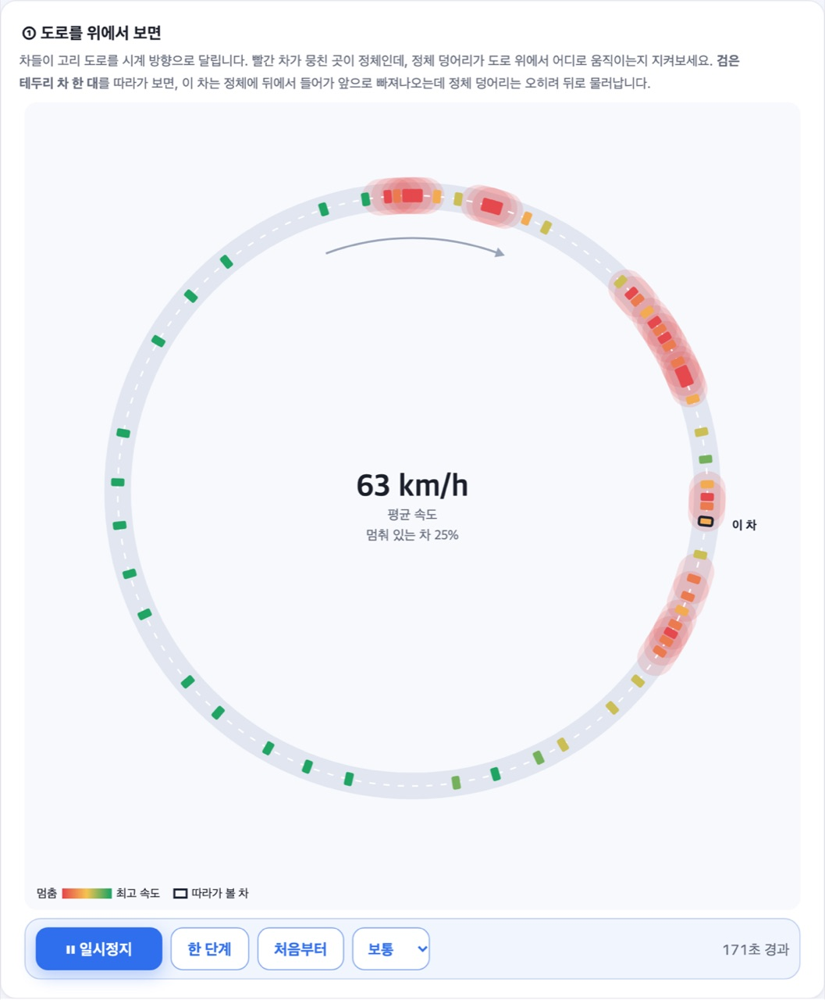
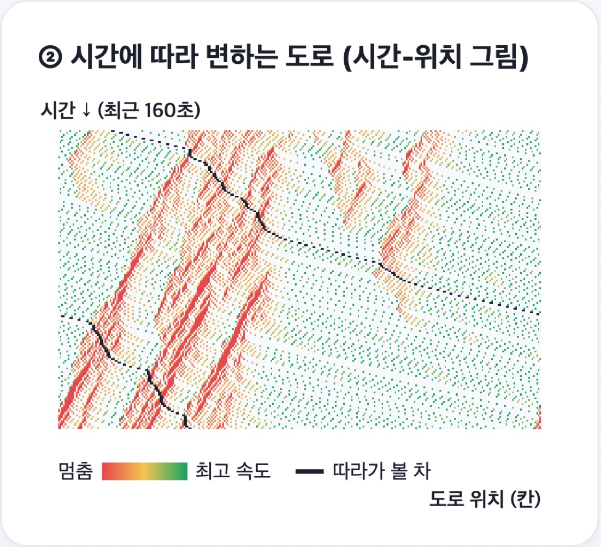
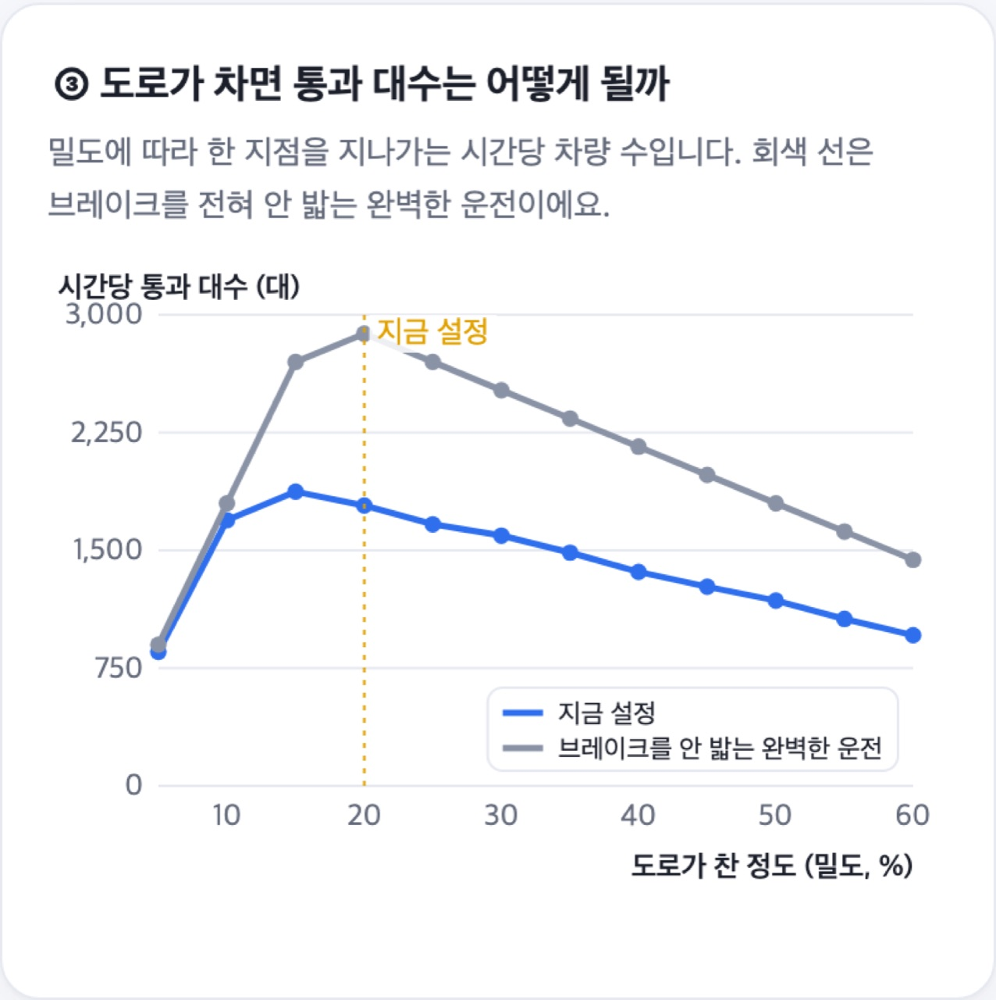

브레이크등이 끝없이 이어져 있었다. 라디오에서는 같은 보험 광고가 세 번째 흘러나왔다.

처음엔 짜증이었다. 사고가 났겠거니, 공사 중이겠거니 하며 앞을 노려봤다. 그다음엔 체념. 핸들에 손을 얹은 채 앞차 꽁무니만 보고 있으면, 시간이 내 것이 아닌 것처럼 느껴진다. **누군가 내 저녁을 조금씩 떼어 가는 기분.**

{{photo a | 해 질 녘 고속도로 정체, 운전석에서 본 끝없는 브레이크등 | Photorealistic photo taken from the driver's seat of a car stuck in a long expressway traffic jam at dusk in Korea, rows of red brake lights stretching to the horizon, no accident, no roadwork, nothing blocking the road, light rain on the windshield, 35mm lens, natural light, documentary style, no readable license plates, no logos, no text}}

이십 분쯤 지났을까. 길이 거짓말처럼 열렸다. 나는 속도를 올리며 창밖을 살폈다. 부서진 차도, 주황색 고깔도, 길에 떨어진 짐도 없었다.

!! 앞에는 아무것도 없었다.

이상하게 그 순간이 더 억울했다. 사고라도 있었다면 납득했을 텐데. 화낼 대상이라도 있었다면 차라리 나았을 텐데. **범인 없는 이십 분은, 따질 곳 없는 손해처럼 오래 남았다.**

집에 와서도 그 질문이 떠나지 않았다. 그 이십 분은 어디에서 왔을까. 누가 내 시간을 가져갔을까.

---

### 이유 없는 망설임

궁금한 건 못 참는 성격이라, 결국 그 장면을 컴퓨터 속에 다시 세워 보았다.

둥근 길 위에 차 60대를 올렸다. 그리고 아주 단순한 약속만 쥐여 주었다. 앞이 비면 나아가고, 가까워지면 물러서고, 가끔은 아무 이유 없이 잠깐 망설일 것.

라디오 채널을 돌리다가. 휴대폰 알림에 눈이 가다가. 괜히 마음이 불안해서. 누구에게나 있는 그 짧은 머뭇거림이다.

**그것만으로 길이 막혔다.** 사고는 한 번도 나지 않았다. 그런데 평균 108km/h로 달리던 차들이 63km/h로 떨어졌다. 40% 넘게 느려진 것이다.

앞차의 작은 머뭇거림은 뒤차에서 조금 커졌다. 그 뒤에서 더 커졌다. 몇 대만 건너면 멈춤이 되었다.

그리고 나는 한참 동안 화면 앞에 앉아 있었다. 이상한 장면을 봤기 때문이다. **차들은 모두 앞으로 가는데, 막힘은 뒤로 흘러가고 있었다.**

@@ 멈춤이 물결처럼 뒤로 번지는 모습은 직접 보는 편이 낫다. | 이유 없는 망설임이 만드는 정체, 직접 돌려 보기 | https://simulatiolab.com/traffic

---

### 길 밖의 정체

그 물결을 한 번 보고 나니, 길 밖에서도 자꾸 보였다.

단톡방에서 누군가 묻는다. "다들 언제 괜찮아?" "난 아무 때나." "나도." "주말은 좀 애매한데, 평일도 괜찮고." 누구도 반대하지 않았다. 모두가 서로를 배려했다. **그런데 약속은 몇 주째 잡히지 않는다.**

출근길 지하철 계단 맨 위에서 누군가 휴대폰을 보느라 반걸음 멈춘다. 그는 곧 다시 걷는다. 하지만 계단 아래에는 그 반걸음이 수십 사람의 멈춤이 되어 고여 있다. 정작 그는 그 줄을 보지 못한다. 이미 앞서 걷고 있으니까.

{{photo b | 출근길 지하철 계단, 맨 위의 반걸음이 아래에서 멈춤이 된다 | Photorealistic photo of a crowded subway station staircase at morning rush hour in Seoul, commuters bunched up at the bottom of the stairs while one person at the top has paused to look at a phone, slight motion blur on the crowd, faces not identifiable, no logos, no readable signs, natural light}}

친구의 메시지에 "나중에 제대로 답해야지" 하며 하루를 미룬다. 친구는 늦어지는 답장 앞에서 다음 말을 조금 망설인다. 나는 그 망설임을 느끼고 조금 더 미룬다. 멀어지자고 한 사람은 아무도 없었다. 그런데 둘 사이에 정체가 생긴다.

---

### 내가 남긴 물결

우리는 이야기에 악당이 있기를 바란다. 막힌 길에는 사고 차가, 망한 일에는 잘못한 사람이 있어야 마음이 놓인다.

그런데 둥근 길 위에 악당은 없었다. 굳이 찾자면 모두가 조금씩 범인이었다. 그래서 누구도 범인이 아니었다.

막힘이 뒤로 흐른다는 사실이 오래 마음에 걸렸다. **내가 망설인 대가는 내가 치르지 않는다.** 그것은 나를 뒤따르는 사람에게 건너간다. 나는 이미 앞서가 있기에, 내가 남긴 물결을 끝내 보지 못한다.

반대로 지금 내가 갇힌 막힘의 시작도 나는 영영 모른다. 그곳에 도착했을 때, 앞에는 아무것도 없을 테니까.

---

실험에서 가장 오래 남은 장면은 따로 있다. 길이 한산할 때는 똑같이 망설여도 막힘이 생기지 않았다. 차와 차 사이의 빈 곳이 그 흔들림을 받아 주었다. 길이 빽빽해질수록, 같은 망설임이 더 큰 멈춤이 되었다.

{{photo c | 새벽의 한산한 도로, 차와 차 사이의 넉넉한 빈 곳 | Photorealistic high-angle photo of a calm multi-lane road at dawn with only a few cars spaced far apart, soft morning fog, pale blue and warm light, peaceful mood, no logos, no readable signs, no people visible}}

사람은 누구나 망설인다. 그건 고칠 수 없다. 바꿀 수 있는 건 그 망설임이 놓일 자리다. 일정과 일정 사이의 빈칸. 약속과 약속 사이의 숨. 사람과 사람 사이에 놓아 두는 "늦어도 괜찮아"라는 한마디.

빈 곳이 있으면, 누군가의 작은 흔들림은 정체가 되지 않는다. 그저 지나가는 바람이 된다.

다음에 아무 이유 없이 길이 막히면, 아니 아무 이유 없이 하루가 막히면, 범인을 찾기 전에 이렇게 물어보고 싶다.

> 지금 내 삶에는 빈 곳이 남아 있는가?

%% 오늘의 인사이트
- **막힘의 원인은 지금 여기에 없을 수 있다.** 정체의 시작은 이미 몇 분 전, 몇 대 앞에서 지나갔다. 일이 꼬일 때 눈앞의 사람을 탓하기 전에, 흐름이 어디서 흔들렸는지 거슬러 올라가 보자.
- **작은 망설임은 뒤로 갈수록 커진다.** 내 답장 하나, 결정 하나를 미루면 그 비용은 나를 기다리는 사람들에게 불어난 채로 건너간다. 결정은 "완벽하게"보다 "빨리, 작게".
- **빈 곳이 흔들림을 받아 준다.** 일정 사이 15분, 앞차와의 넉넉한 거리, 마감 앞의 하루. 사람은 망설임을 없앨 수 없지만, 그 망설임이 정체가 되지 않게 할 여백은 만들 수 있다.

여러분이 겪은 "이유 없는 정체"는 어디였나요? 길 위든, 단톡방이든, 댓글로 들려주세요.

~~ 덧붙임. 둥근 길 실험은 실제로도 있었다. 2008년 일본의 연구진은 원형 트랙에 차 스물두 대를 올리고 같은 속도로 달리게 했는데, 아무 장애물 없이도 정체가 저절로 생겨났다(Sugiyama 외, 2008). 글 속의 숫자는 실제로 돌린 시뮬레이션의 결과(2.25km 고리 도로, 차 60대)이며, 실험 제작과 글 정리에 AI(Claude)의 도움을 받았다.
