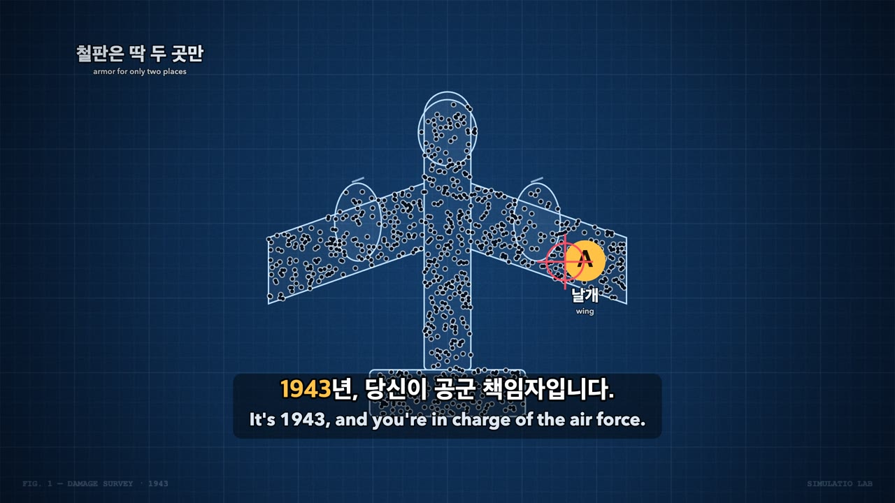

1943년, 당신이 공군 책임자라고 해 보자. 전쟁터에서 돌아온 폭격기들이 활주로에 줄지어 서 있다. 날개와 몸통에는 총알 구멍이 수백 개다. 엔진 쪽은 이상할 만큼 깨끗하다.

철판은 무거워서 비행기 전체를 두를 수는 없다. 딱 두 곳만 덧댈 수 있다면, 어디를 막아야 할까.

!! 구멍이 가장 많은 날개와 몸통?

거의 모든 사람이 그렇게 답한다. 나도 처음엔 그랬다.

---

### 2,000번 띄워 보았다

말로만 따지면 헷갈리니까, 컴퓨터 속에서 직접 띄워 보았다. 비행기 2,000대가 출격하고, 한 대에 평균 총알 세 발이 무작위로 박힌다. 날개나 몸통에 맞으면 대개 버티고 돌아온다. 엔진이나 조종석에 맞으면 대개 돌아오지 못한다.

결과는 이랬다. 100대가 출격했을 때,

- 철판이 없으면 68대가 돌아온다.
- 구멍이 많은 날개와 몸통에 철판을 붙이면 71대.
- 구멍이 거의 없던 엔진과 조종석에 붙이면 83대.

엔진에 구멍이 없었던 건 엔진이 튼튼해서가 아니었다. 엔진에 맞은 비행기는 활주로까지 돌아오지 못했기 때문이다. 우리가 본 구멍 지도는 "맞아도 버틸 수 있는 곳"의 지도였다.

통계학자 에이브러햄 월드가 바로 이 지점을 짚었다고 전해진다. 구멍이 많은 곳이 아니라, 구멍이 없는 곳을 막으라고.

@@ 엔진에 철판을 붙이면 정말 더 많이 돌아올까? 숫자를 바꿔 가며 직접 확인해 보자. | 돌아오지 못한 비행기 실험, 직접 돌려 보기 | https://simulatiolab.com/survivor

---

### 살아남은 것만 보는 순간들

이 함정에는 이름이 있다. 생존자 편향. 살아남은 것만 보고 판단하다가 틀리는 것이다.

휴대폰 수리 센터에 가 보면, 깨진 화면을 들고 온 사람이 대부분이다. 그럼 화면이 휴대폰에서 가장 약한 부분일까? 아니다. 기판이 망가진 휴대폰은 수리 센터가 아니라 서랍이나 쓰레기통으로 간다. 수리 센터는 "고칠 수 있게 망가진 것"만 모이는 곳이다.

1차 대전에 철모를 처음 썼을 때, 머리를 다쳐 병원에 오는 병사가 오히려 늘었다는 이야기도 있다. 철모가 쓸모없었던 걸까? 철모 덕분에 예전 같으면 현장에서 목숨을 잃었을 병사들이 다친 채로 병원에 올 수 있게 된 것이다.

높은 곳에서 떨어진 고양이를 조사했더니, 아주 높은 층에서 떨어진 고양이가 덜 다쳤다는 연구도 있다(1987). 높이 떨어질수록 안전한 걸까? 크게 다친 고양이는 병원에 오지 못했을 수 있다. 우리가 본 기록에는 살아서 병원에 온 고양이만 있다.

---

### 성공담이라는 활주로

성공한 사람의 이야기도 활주로에 돌아온 비행기와 닮았다.

"꾸준히만 하면 된다." "교과서 위주로 공부했다." "30년째 이 자리에서 장사했다." 모두 진심이고, 거짓말도 아니다. 다만 같은 방법으로 꾸준히 했지만 조용히 사라진 사람들은 인터뷰를 하지 않는다. 문을 닫은 가게는 골목에 간판을 남기지 않는다.

그래서 성공담을 들을 때 나는 세 가지를 묻기로 했다.

1. 여기 없는 사람은 누구인가.
2. 같은 방법으로 실패한 경우는 몇이나 되나.
3. 사라진 이야기는 어디로 갔나.

이 질문은 남의 이야기에만 쓰는 게 아니다. 내가 "이렇게 했더니 됐다"고 말할 때도, 나는 활주로에 돌아온 비행기일지 모른다.

> 보이지 않는 사람들이 이야기의 절반이다.

~~ 덧붙임. 글 속의 숫자는 시뮬레이션 결과다(출격 2,000번, 평균 총알 3발, 철판 2곳, 200번 반복 평균을 100대 기준으로 반올림). 실제 기종이나 전쟁 기록의 수치가 아니다. 월드 일화는 널리 알려진 단순한 버전이며(Wald 1943; Mangel & Samaniego 1984), 철모 이야기는 널리 전해지는 일화다. 고양이 연구는 Whitney & Mehlhaff(1987). 그림은 직접 만든 시뮬레이션과 3D 모형이며, 글 정리에 AI(Claude)의 도움을 받았다. 같은 이야기를 8분 영상으로도 만들었다.
