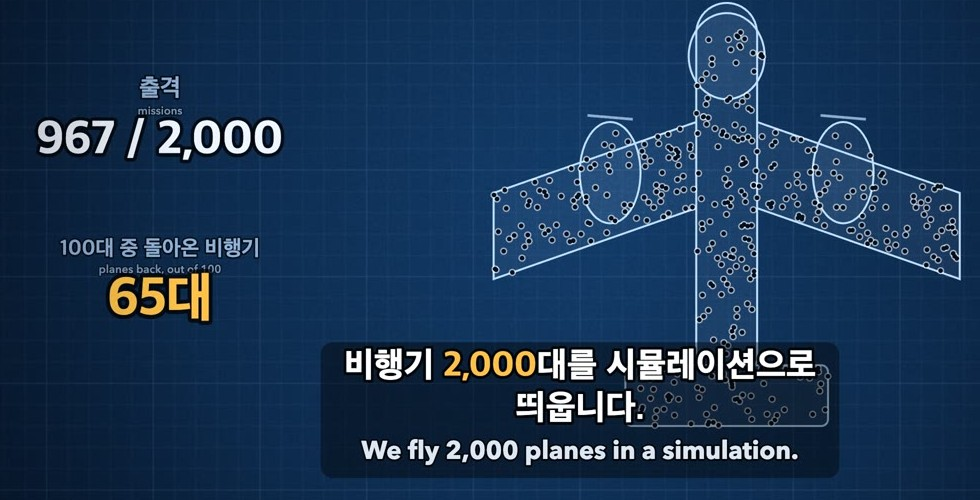
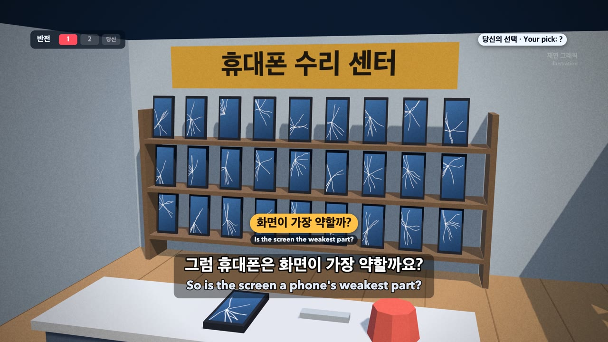
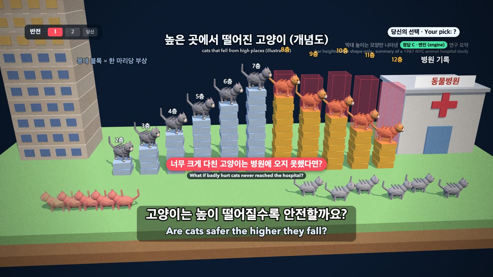

1943년. 당신은 공군 책임자다.

전쟁터에서 돌아온 폭격기들이 활주로에 줄지어 서 있다. 날개와 몸통은 총알 구멍투성이다. 엔진 쪽은 이상할 만큼 깨끗하다.

{{photo a | 전쟁에서 돌아온 폭격기 날개의 총알 구멍(재현 이미지) | Photorealistic close-up photo in the style of a 1940s documentary of a battle-damaged four-engine bomber wing on a grass airfield, the aluminum skin riddled with bullet holes, mechanics in the blurred background, overcast sky, film grain, no national insignia, no unit markings, no text}}

철판은 무겁다. 비행기 전체를 두를 수는 없다. 딱 두 곳만 덧댈 수 있다면, 어디를 막겠는가.

잠깐 스크롤을 멈추고 골라 보자. 날개? 몸통? 엔진?

!! 구멍이 가장 많은 날개와 몸통.

거의 모든 사람이 그렇게 답한다. 나도 그랬다. 그래서 확인해 보기로 했다.

---

### 2,000번 띄워 보았다

컴퓨터 속에서 폭격기 2,000대를 띄웠다. 한 대에 평균 세 발씩, 총알이 무작위로 박힌다. 어디에 맞았느냐에 따라 돌아오기도 하고, 돌아오지 못하기도 한다.

그리고 철판을 붙이는 곳만 바꿔 가며 몇 대가 돌아오는지 셌다. 100대가 출격했을 때,

- 철판이 없으면 **68대**.
- 구멍이 많은 날개와 몸통에 붙이면 **71대**.
- 구멍이 거의 없던 엔진과 조종석에 붙이면 **83대**.

결과를 보고 나는 잠깐 멍해졌다. 구멍이 없는 곳을 막았더니 가장 많이 돌아왔다.

이유는 단순했다. **엔진에 구멍이 없었던 건, 엔진에 맞은 비행기가 돌아오지 못했기 때문이다.** 활주로의 구멍 지도는 "맞아도 버틸 수 있는 곳"의 지도였다. 정말 위험한 곳은 지도에서 비어 있었다.

통계학자 에이브러햄 월드가 짚은 것이 바로 이 빈칸이었다. 구멍이 많은 곳이 아니라, 구멍이 없는 곳을 막으라고.

@@ 정말 그럴까? 철판 위치를 바꿔 가며 직접 확인해 보자. | 돌아오지 못한 비행기 실험, 직접 돌려 보기 | https://simulatiolab.com/survivor

---

### 수리 센터의 착각

이 함정에는 이름이 있다. **생존자 편향.** 살아남은 것만 보고 판단하다가 틀리는 것.

휴대폰 수리 센터에 가 보면, 손님 대부분이 깨진 화면을 들고 온다. 수리 기사에게 물으면 아마 이렇게 말할 것이다. "휴대폰은 화면이 제일 약해요."

{{photo b | 화면 깨진 휴대폰이 줄지어 놓인 수리 센터 카운터 | Photorealistic photo of a small phone repair shop counter with a row of smartphones that all have cracked screens, repair tools and tiny screwdrivers nearby, shallow depth of field, warm indoor light, no brand logos, no readable text}}

그런데 물에 빠져 기판이 나간 휴대폰은 어디로 갈까. 수리 센터가 아니라 서랍이나 쓰레기통으로 간다. 고쳐 봐야 소용없으니까. **수리 센터는 "고칠 만하게 망가진 것"만 모이는 활주로다.** 기사가 매일 보는 건 돌아온 비행기뿐이다.

높은 곳에서 떨어진 고양이도 그렇다. 동물병원 기록을 보면 아주 높은 층에서 떨어진 고양이가 오히려 덜 다친 것처럼 보인다. 하지만 기록에는 살아서 병원에 온 고양이만 남는다.

---

### 성공담이라는 활주로

성공한 사람의 이야기도 활주로에 돌아온 비행기를 닮았다.

"꾸준히만 하면 된다." "교과서 위주로 공부했다." "30년째 이 자리에서 장사했다."

모두 진심이고, 거짓말도 아니다. 다만 똑같이 꾸준했는데 조용히 사라진 사람들은 인터뷰를 하지 않는다. 문을 닫은 가게는 골목에 간판을 남기지 않는다.

{{photo c | 붐비는 오래된 맛집 골목 사이, 셔터가 내려간 빈 가게 하나 | Photorealistic evening photo of a narrow old restaurant alley in Seoul, warm lights and customers at busy restaurants, and one shop in between with its metal shutter closed and an empty storefront, signs blurred or unreadable, faces not identifiable, no logos}}

그래서 나는 성공담을 들으면 세 가지를 묻는다.

1. 여기 없는 사람은 누구인가.
2. 같은 방법으로 실패한 경우는 몇이나 되나.
3. 사라진 이야기는 어디로 갔나.

솔직히 고백하자면, 이 블로그도 활주로다. 돌려 봤는데 싱거웠던 실험, 결과가 이상해서 접은 실험은 여기 올라오지 않는다. 여러분이 읽는 건 돌아온 비행기뿐이다.

!! 보이지 않는 사람들이 이야기의 절반이다.

%% 오늘의 인사이트
- **"여기 없는 것"부터 찾아라.** 별점 리뷰에는 실망해서 조용히 떠난 손님이 없고, 퇴사 면담에는 이미 떠난 사람의 진짜 이유가 없다. 숫자를 보기 전에 "누가 이 자료에서 빠졌나"를 먼저 묻자.
- **성공담은 방법이 아니라 표본 하나다.** "이렇게 했더니 됐다"는 같은 방법으로 안 된 사람 수를 알기 전까지는 확률을 말해 주지 않는다.
- **내 경험도 활주로다.** 내가 남에게 조언할 때도, 나는 돌아온 비행기 한 대일 뿐이다. 그래서 "나는 이랬다"와 "너도 그럴 것이다" 사이에 한 칸을 띄워 두자.

여러분이 들은 성공담 중에 "돌아오지 못한 비행기"가 떠오르는 이야기가 있나요? 댓글로 나눠 주세요.

~~ 덧붙임. 글 속의 숫자는 시뮬레이션 결과다(출격 2,000번, 평균 총알 3발, 철판 2곳, 200번 반복 평균을 100대 기준으로 반올림). 실제 기종이나 전쟁 기록의 수치가 아니다. 월드의 일화는 널리 알려진 단순한 버전이다(Wald 1943; Mangel & Samaniego 1984). 고양이 연구는 Whitney & Mehlhaff(1987)이며, 여러 해석이 있다. 그림은 직접 만든 시뮬레이션과 3D 모형이며, 글 정리에 AI(Claude)의 도움을 받았다. 같은 이야기를 8분 영상으로도 만들었다.
