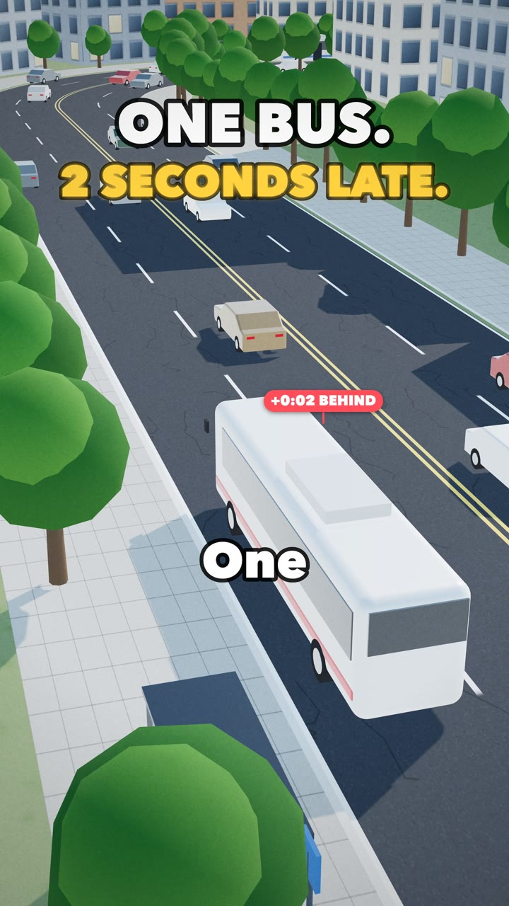
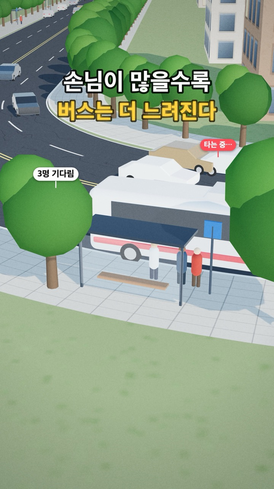
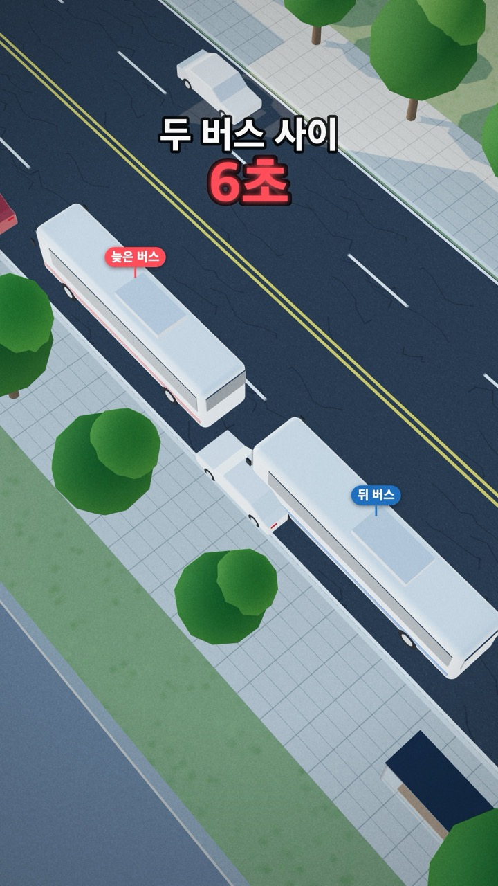
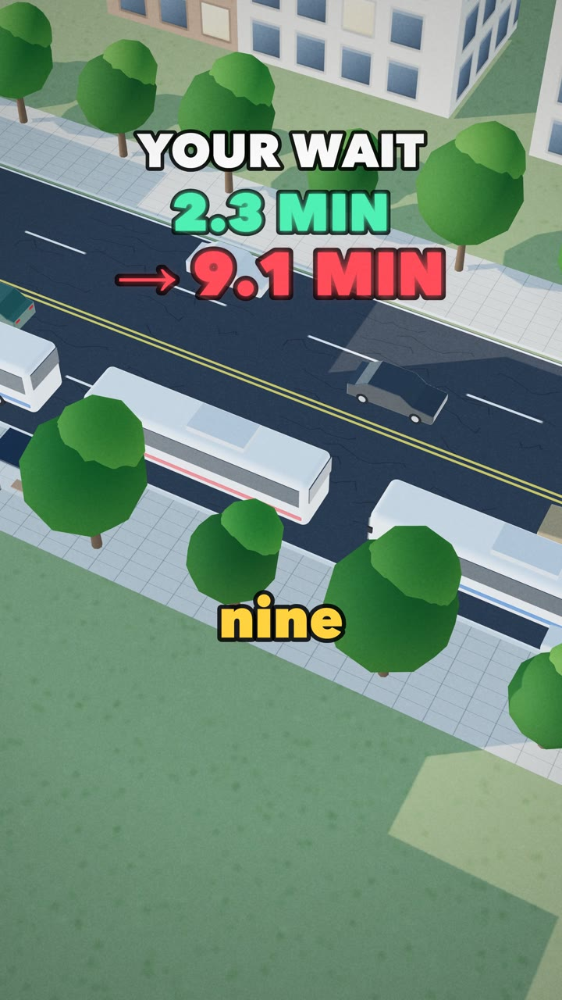

버스가 정류장에 섰다. 탈 사람은 다 탔다. 문도 닫혔다. 그런데 출발하지 않는다.

십 초. 이십 초. 나는 속으로 기사님을 재촉했다. 아니, 왜 안 가요.

그날 저녁 나는 그 버스를 다시 생각하게 됐다. 정확히는, 그 버스가 왜 기다렸는지 알게 됐다.

{{photo a | 출발하지 않고 잠깐 서 있는 버스 | Photorealistic photo of a single city bus waiting at a quiet bus stop at dusk with its doors open and engine idling, warm interior light, a few passengers seated, calm mood, no readable route numbers, no logos, no readable text}}

---

### 버스는 왜 두 대씩 올까

먼저 반대 장면부터. 배차 간격 5분이라던 버스를 한참 기다렸는데, 두 대가 나란히 온다. 앞차는 꽉 찼고, 뒤차는 텅 비었다.

{{photo b | 기다리던 버스가 두 대 나란히 들어오는 정류장 | Photorealistic photo of two city buses arriving one right behind the other at a city bus stop on a rainy evening, the first bus crowded, the second bus almost empty, wet reflective road, people waiting under the shelter seen from behind, no readable route numbers, no company logos, no readable text}}

기사님이 게으른 걸까. 배차를 엉터리로 짠 걸까. 궁금한 건 못 참는 성격이라, 컴퓨터 속에 버스 노선을 하나 만들었다.

!! 아무도 잘못하지 않아도, 버스는 뭉친다.

---

### 2초의 시작

정류장 24곳을 도는 순환 노선. 버스 6대가 약 4분 40초 간격으로 고르게 출발한다. 승객은 정류장마다 꾸준히 와서 줄을 서고, 버스는 줄이 빌 때까지 태운다.

딱 하나만 어긋나게 했다. 버스 한 대가 앞차보다 2초쯤 늦게 출발한다.

2초. 신호 한 번 놓친 것보다 짧다.

그런데 그 버스가 다음 정류장에 도착하면, 앞차가 떠난 지 2초 더 지난 셈이다. 그사이 사람이 조금 더 와 있다. 사람이 많으니 태우는 데 조금 더 걸린다. 그래서 다음 정류장에는 조금 더 늦게 닿는다. 거기엔 사람이 조금 더 많다.

**늦을수록 더 늦어지는 고리.** 한번 들어가면 혼자서는 빠져나오지 못한다.

---

### 뒤차는 거꾸로 빨라진다

뒤따라오는 버스는 정반대다. 앞차가 사람을 많이 태워 갔으니 정류장이 한산하다. 금방 태우고 금방 떠난다. 점점 빨라진다.

앞차는 점점 느려지고, 뒤차는 점점 빨라진다. 간격은 줄어들 수밖에 없다.

화면 속 두 버스는 출발 후 두 시간쯤 지나 딱 붙어 버렸다. 같은 일이 다른 버스들 사이에서도 일어났다.

여섯 시간 뒤. **고르게 흩어져 있던 버스 6대가 한 덩어리가 되어 함께 달리고 있었다.** 정류장에는 버스 여섯 대가 줄줄이 지나간 뒤, 한참 동안 아무것도 오지 않았다.

정류장에서 기다리는 시간은 평균 2.3분에서 9.1분이 됐다. 버스 수도, 승객 수도, 도로도 그대로인데.

@@ 버스를 늘리거나, 일부러 기다리게 하면 어떻게 될까. 직접 돌려 보자. | 버스 몰림 실험, 직접 돌려 보기 | https://simulatiolab.com/bunching

---

### 거꾸로 같은 해법

버스를 6대에서 8대로 늘려 봤다. 평균 기다림은 5.3분으로 줄었다. 하지만 8대가 고르게 다닐 때(1.7분)의 세 배다. 버스는 여전히 뭉쳤다. 더 빨리 달리게 해도 7.6분. 역시 뭉쳤다.

효과가 있었던 건 거꾸로 들리는 방법이었다. **버스를 정류장에서 기다리게 하는 것.** 앞차와의 간격이 충분히 벌어질 때까지 뒤차가 잠깐 서 있으면, 뭉침이 풀리고 평균 기다림이 다시 2분대로 돌아왔다.

1964년, 두 연구자(Newell과 Potts)가 이 고리를 처음 정리했다. 지금도 많은 도시가 간격을 맞추려고 버스를 정류장에 잠깐 세운다.

그러니까 그날 출발하지 않던 버스는, 게으른 게 아니었을지도 모른다. 다음 정류장에서 기다리는 누군가를 위해, 앞차와의 거리를 재고 있었을지도.

이제 나는 서 있는 버스 안에서 재촉하지 않는다. 대신 창밖을 본다. 저 앞 어딘가에서, 내 버스가 지켜 준 간격만큼 누군가의 기다림이 줄어들고 있을 테니까.

여러분 동네 버스는 어떤가요? 두 대씩 오는 노선이 있다면 댓글로 알려 주세요.

~~ 덧붙임. 글 속의 숫자는 사이트 시뮬레이션 모델 결과다(정류장 24곳, 버스 6대, 승객 시간당 40명, 시드 1. 평균 기다림은 8번 반복 평균). 실제 노선의 기록이 아니다. 근거: G. F. Newell & R. B. Potts (1964), "Maintaining a bus schedule". 그림은 직접 만든 3D 시뮬레이션 화면이며, 글 정리에 AI(Claude)의 도움을 받았다.
