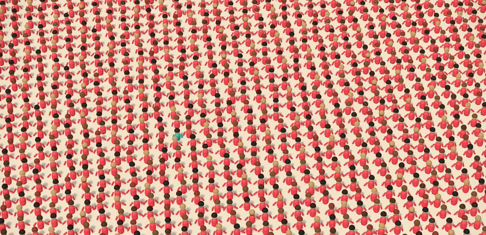
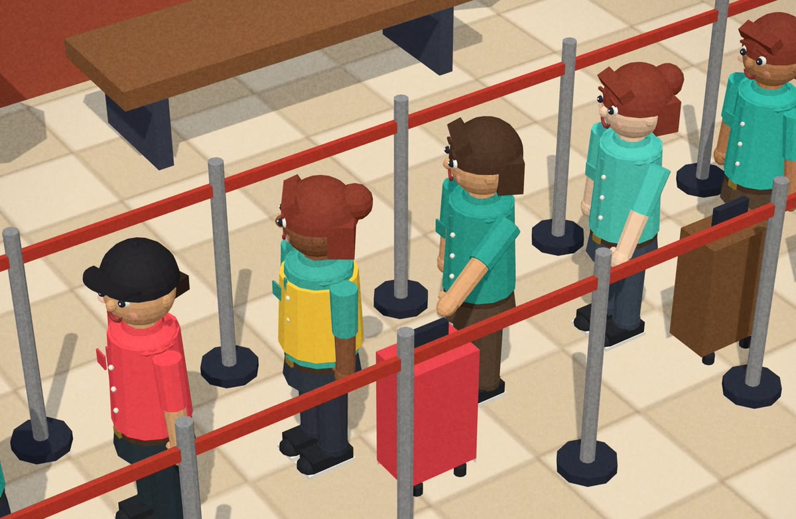
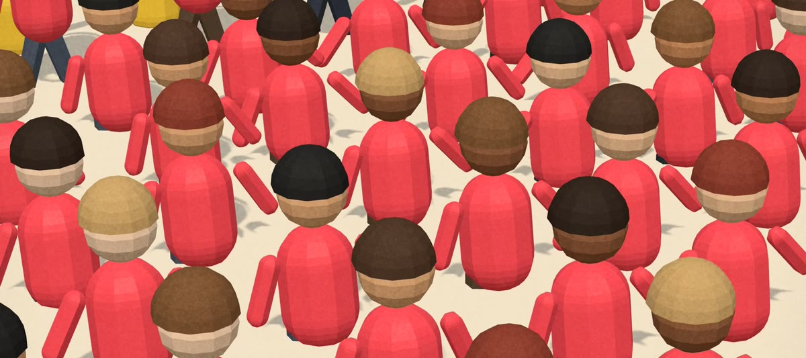
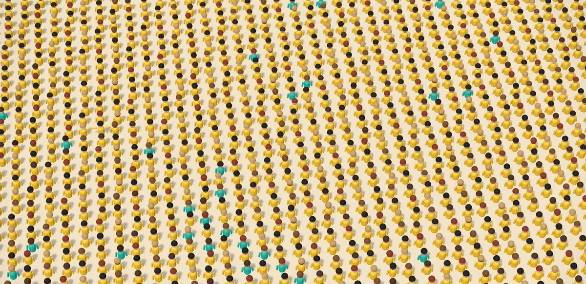
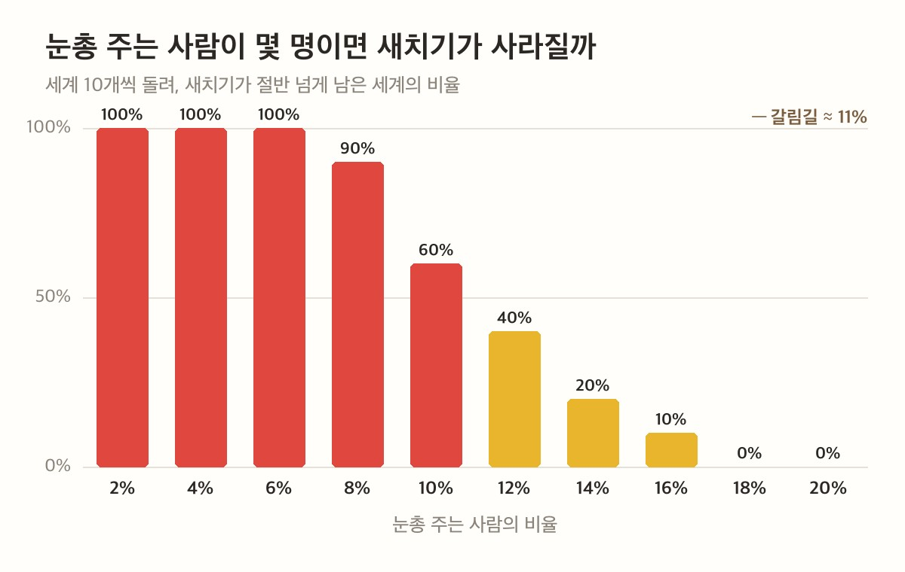

저녁 마트 계산대. 장바구니 손잡이가 손가락을 파고든다. 앞에는 세 사람. 삑, 삑, 바코드 찍히는 소리만 규칙적으로 들린다.

그때 누군가 옆에서 "잠깐만요" 하더니, 내 앞으로 쓱 들어선다. 손에는 우유 하나.

{{photo a | 저녁 마트 계산대 앞의 줄, 장바구니를 든 손 | Photorealistic photo of a supermarket checkout line in the evening in Korea, close-up of a hand holding a heavy plastic shopping basket in the foreground, a few shoppers waiting ahead seen from behind, fluorescent light, shallow depth of field, faces not identifiable, no logos, no readable text or prices}}

얼굴이 확 달아올랐다. 저기요, 줄 서 있는데요. 그 한마디가 목까지 올라왔다. 그런데 나는 먼저 주위를 둘러봤다. 뒤에 선 사람도, 그 뒤의 사람도 휴대폰만 보고 있었다. 아무도 말하지 않았다. **그래서 나도 말하지 않았다.**

삑. 우유 한 팩이 먼저 지나갔다. 겨우 십 초쯤이었다.

마트를 나와서도 그 십 초가 계속 따라왔다. 이상하게 화가 난 건 새치기한 사람보다 나 자신이었다. 왜 한마디를 못 했을까. 그리고 또 하나. 새치기가 그렇게 쉽고 이득이라면, **왜 대부분의 사람은 여전히 줄을 설까.**

---

### 따라 하기만 하는 2,500명

질문이 생기면 나는 컴퓨터 속에 작은 세상을 세운다. 이번에는 바둑판 같은 광장에 사람 2,500명을 세웠다.

규칙은 하나다. 사람들은 매번 둘레의 이웃 여덟 명과 마주치며 시간을 아끼거나 잃는다. 새치기하면 남의 시간을 가져온다. 그리고 한 판이 끝날 때마다, **주변에서 가장 이득을 본 사람의 방식을 그대로 따라 한다.** 처음에는 다섯 명 중 한 명만 새치기꾼이었다.

결과는 허무할 만큼 빨랐다. 단 두 판 만에 새치기가 **99.7%**가 되었다.

그런데 모두가 새치기를 하자, 모두가 손해를 봤다. 한 사람이 한 판에 얻는 몫이 1.00에서 **0.875**로 줄었다. 끼어들 줄이 없으니 서로 밀치기만 하는 셈이다. **새치기는 다른 사람이 줄을 서 줄 때만 이득이다.**

그렇다면 질문이 바뀐다. 이 빨간 광장을 다시 줄 서는 세상으로 돌려놓으려면 무엇이 필요할까.

---

### 눈총 한 번의 값

이번에는 세 번째 사람을 섞었다. 자기도 줄을 서고, 새치기를 보면 한마디 하거나 노려보는 사람. **눈총 주는 사람**이다.

눈총은 공짜가 아니다. 말을 꺼내는 데는 용기가 들고, 분위기는 불편해진다. 그래서 모델에서도 눈총을 준 사람은 자기 몫이 조금 깎인다. 대신 눈총을 받은 새치기꾼은 더 크게 잃는다.

여기서 잠깐 골라 보자. 눈총 주는 사람이 몇 명이면 새치기가 사라질까.

- A. 스무 명 중 한 명
- B. 다섯 명 중 한 명
- C. 절반은 되어야

나는 C라고 생각했다. 다들 휴대폰만 보던 그 줄이 떠올랐으니까.

먼저 스무 명 중 한 명. 새치기는 **99.9%**까지 번졌고, 눈총 주던 사람들은 손해만 보다가 모두 새치기로 돌아섰다.

다음은 다섯 명 중 한 명. 처음 몇 판은 오히려 더 나빠졌다. 새치기가 **97.4%**까지 폭발했다. 역시 안 되는구나 싶었다.

그런데 화면 귀퉁이에서 노란 점들이 조금씩 번지기 시작했다. 19판째, 새치기는 1% 아래로 떨어졌다. 150판 뒤에는 **0.1%**. 광장은 노란색으로 덮여 있었다.

이유는 이랬다. **눈총 한 번은, 새치기로 얻는 이득보다 더 큰 손해를 준다.** 그래서 눈총 주는 사람 곁에서는 새치기꾼이 가장 못사는 사람이 된다. 반대로 눈총 주는 사람들이 모여 있는 곳은 아무도 끼어들지 못해 가장 잘사는 동네가 된다. 따라 하기 좋아하는 이웃들은, 이번에는 그 노란 방식을 따라 했다.

세계를 여러 번 다시 돌려 갈림길을 찾았다. 눈총 주는 사람이 8%면 열 번 중 아홉 번은 새치기가 이겼다. 18%를 넘자 한 번도 이기지 못했다. **뒤집히는 지점은 대략 열 명 중 한 명.**

@@ 눈총 주는 사람의 비율을 직접 바꿔 보면, 광장이 뒤집히는 순간을 볼 수 있다. | 새치기와 눈총 실험, 직접 돌려 보기 | https://simulatiolab.com/queue

---

### 아무도 말하지 않는 줄

그 마트 줄이 다시 떠올랐다. 줄에 선 사람은 다섯 명쯤이었다. 그중 한 명만 있었으면 됐다. 그런데 그날 그 줄에는 한 명도 없었다. 모두 나처럼 생각했을 것이다. **누군가 말하겠지.**

이런 줄은 마트에만 있지 않다.

회식 자리에서 누군가 선 넘는 농담을 던진다. 몇 명이 어색하게 웃는다. 웃지 않으면 분위기를 깨는 것 같아서다. 그러면 그 농담은 "괜찮은 농담"이 되고, 다음에는 조금 더 선을 넘는다. 빨간 점이 번지는 방식 그대로다.

{{photo b | 회식 자리, 아무도 웃지 않는 한 사람의 굳은 손 | Photorealistic photo of a Korean company dinner table at night, close-up on one person's hands resting still beside a soju glass while others at the table are blurred and laughing in the background, warm restaurant light, faces not identifiable, no logos, no readable text}}

그때 필요한 눈총은 거창하지 않다. 따라 웃지 않는 것. "에이, 그건 좀." 한마디. 다섯 명 중 한 명이 그 정도만 해도, 그 자리의 규칙이 바뀐다.

생각해 보면 나도 평소에 새치기를 하지 않는다. 착해서만은 아니다. 뒤통수에 꽂힐 눈빛이 먼저 떠오르기 때문이다. 어쩌면 **질서는 법보다, 누군가 치러 준 작은 불편함으로 유지되고 있었다.** 내가 아무 말 없이 서 있던 수많은 줄도, 누군가의 눈총 덕분에 줄이었던 것이다.

---

이제 그날의 자책이 조금 다르게 보인다. 모두가 용감할 필요는 없었다. 다섯 명 중 한 명이면 됐다. 그리고 그 한 명은, 화를 내는 사람이 아니라 짧게 말하는 사람이면 충분했다.

다음에 누군가 내 앞으로 쓱 들어온다면, 나는 크게 숨 한 번 쉬고 웃으며 말해 볼 생각이다.

!! "저기, 줄 여기부터예요."

{{photo c | 바닥의 줄 서기 표시선과 그 뒤로 가지런히 선 발들 | Photorealistic low-angle photo of a floor queue marking line at a store counter, with several pairs of shoes standing neatly in a row behind it, soft daylight, calm orderly mood, no faces, no logos, no readable text}}

%% 오늘의 인사이트
- **질서는 공짜가 아니다.** 줄이 줄로 남아 있는 건, 누군가 불편함을 감수하고 한마디 해 왔기 때문이다. 다음에 그런 사람을 보면 속으로라도 고맙다고 하자.
- **모두가 나설 필요는 없다. 열 명에 한두 명이면 된다.** 팀에서 이상한 관행을 바꾸고 싶다면 혼자 싸우기보다, 같은 생각을 가진 사람 두세 명을 먼저 찾자. 그 작은 무리가 갈림길을 넘긴다.
- **눈총은 화가 아니라 신호다.** 짧고 부드러울수록 내가 치를 비용이 줄고, 그래야 더 자주, 더 많은 사람이 할 수 있다. "줄 여기부터예요", "그건 좀." 그 정도면 충분하다.

여러분은 줄에서 새치기를 보면 말하는 편인가요, 참는 편인가요? 댓글로 솔직하게 들려주세요.

~~ 덧붙임. 글 속의 숫자는 사이트 시뮬레이션 모델 결과다(50×50 격자 2,500명, 이웃 8명, 새치기 이득 0.5, 눈총의 손해 1.0, 눈총 주는 비용 0.2, 처음 새치기 20%, 150판, 시드 1. 갈림길 그래프는 설정마다 세계 10개 평균). 실제 사람들의 행동을 잰 수치가 아니다. 모델은 공간 진화 게임(Nowak & May, 1992, Nature)을 바탕으로 했다. 실제 대기 줄에 연구자가 끼어들어 사람들의 반응을 관찰한 현장 실험도 있다(Milgram, Liberty, Toledo & Wackenhut, 1986). 그림은 직접 만든 3D 시뮬레이션 화면이며, 글 정리에 AI(Claude)의 도움을 받았다.
