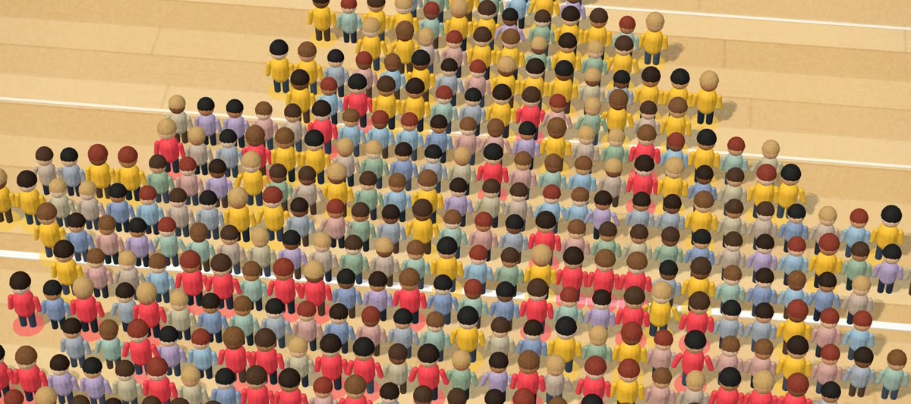
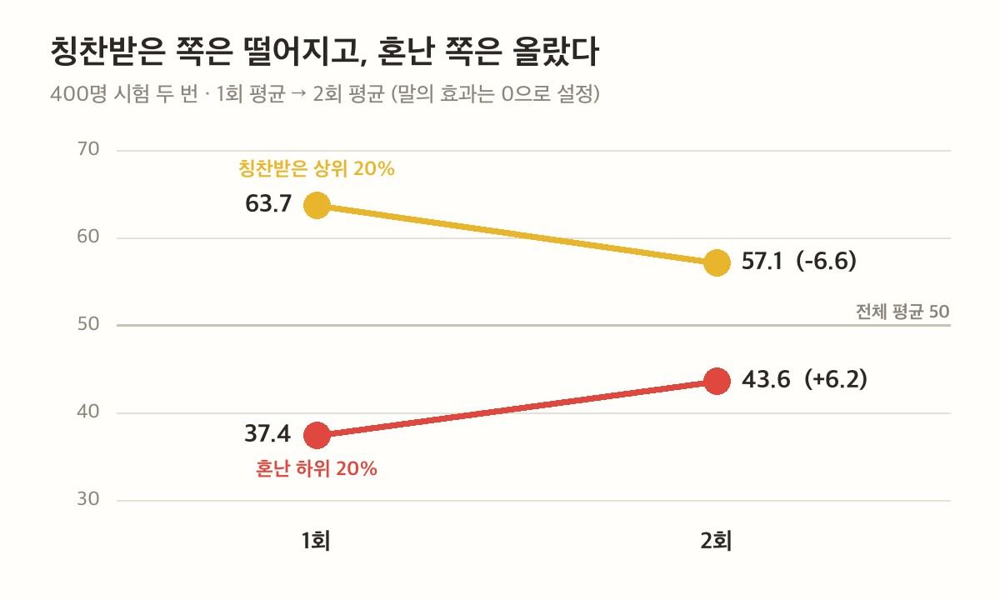
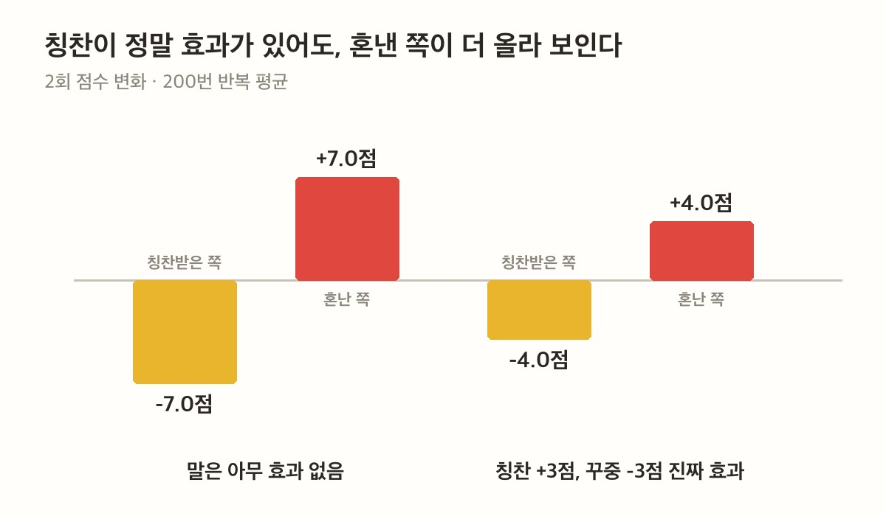
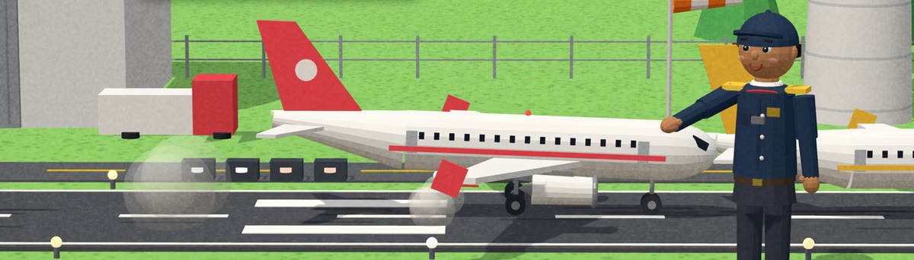

아이가 받아쓰기 백 점을 받아 오면, 그 종이는 냉장고 문으로 간다. 자석 두 개로 반듯하게 붙인다. 오늘은 치킨이다. 잘했다는 말이 몇 번이고 나온다.

그리고 다음 주. 가방에서 꺼낸 종이에는 칠십 점이 적혀 있다.

{{photo a | 냉장고 문에 자석으로 붙여 둔 동그라미 가득한 시험지 | Photorealistic photo of a child's spelling test paper with many red circle marks attached to a refrigerator door with two colorful magnets, warm kitchen light in the evening, shallow depth of field, the writing on the paper blurred and unreadable, no faces, no logos}}

이상하게 서운하다. 칭찬을 그렇게 해 줬는데. 그 서운함 끝에 어른들이 하던 말이 떠오른다. **칭찬하면 풀어진다니까.**

반대의 경험도 있다. 크게 실망한 날, 한숨 섞인 잔소리를 했더니 다음 시험은 올라 왔다. 그 순간 속으로 씁쓸하게 고개를 끄덕인다. 역시 좀 엄하게 해야 하나.

회사도 다르지 않다. 최고의 분기를 보낸 팀을 공개적으로 칭찬하면, 다음 분기엔 꼭 주춤한다. 말이 이렇게 거꾸로 듣는다면, 우리는 앞으로 무슨 말을 해야 할까.

---

### 400명의 두 번째 시험

이 씁쓸한 법칙이 정말인지, 사람 400명에게 시험을 두 번 보게 했다. 물론 컴퓨터 속에서다.

규칙은 단순하다. 점수는 실력과 운이 반반 섞여 정해진다. 실력은 그대로지만, 운은 시험 볼 때마다 새로 뽑힌다. 1회가 끝나면 상위 20%는 칭찬하고, 하위 20%는 혼낸다.

결과는 그 법칙 그대로였다. 칭찬받은 쪽은 평균 **63.7점에서 57.1점**으로 떨어졌다. 혼난 쪽은 **37.4점에서 43.6점**으로 올랐다.

여기서 잠깐 골라 보자. 이 실험에서 효과가 있었던 건 무엇일까.

- A. 칭찬은 독이었다
- B. 꾸중이 약이었다
- C. 둘 다 아무 효과도 없었다

정답은 C다. 나는 이 실험에 미리 설정 하나를 숨겨 두었다. **칭찬과 꾸중이 점수에 미치는 효과를 정확히 0으로 맞춰 둔 것이다.** 아무 말도 하지 않은 것과 똑같았다. 그런데도 칭찬은 독처럼, 꾸중은 약처럼 보였다.

---

### 운은 두 번 오지 않는다

1회에서 상위 20%에 든 사람들을 생각해 보자. 그들은 대체로 실력이 좋다. 하지만 그날 운까지 좋았던 사람이 유난히 많이 섞여 있다. 아는 문제만 나왔거나, 찍은 답이 맞았거나.

2회에도 실력은 그대로 따라온다. **그러나 운은 따라오지 않는다.** 새로 뽑힌 운은 평범하고, 그래서 점수는 가운데 쪽으로 돌아온다. 하위 20%는 정확히 거꾸로다. 운이 나빴던 날의 다음은, 대개 덜 나쁜 날이다.

이것이 **평균으로의 회귀**다. 1886년 프랜시스 골턴이 키가 아주 큰 부모의 자녀가 부모보다는 평균에 가깝다는 것을 보고 처음 이름을 붙였다.

더 놀라운 장면은 그다음이었다. 이번에는 말에 진짜 힘을 주었다. 칭찬하면 실제로 3점이 오르고, 혼내면 실제로 3점이 내려가게. 칭찬이 분명히 옳은 세상이다.

그래도 칭찬받은 쪽은 평균 **4점 떨어졌고**, 혼난 쪽은 **4점 올랐다.** 나는 한동안 이 막대를 보며 말을 잃었다. **칭찬이 옳은 세상에서도, 경험은 꾸중의 편을 든다.**

심리학자 대니얼 카너먼은 비행 교관들에게서 똑같은 믿음을 들었다고 한다. 착륙을 잘해서 칭찬하면 다음엔 못하고, 엉망이어서 소리치면 다음엔 나아지더라고. 교관들이 본 것은 말의 힘이 아니라 운의 되돌림이었다.

@@ 운의 몫을 바꿔 보면 되돌림의 크기가 달라진다. 직접 확인해 보자. | 칭찬과 꾸중 실험, 직접 돌려 보기 | https://simulatiolab.com/regression

운이 차지하는 몫이 클수록 되돌림도 커진다. 점수의 10%만 운인 시험에서는 상위 쪽이 겨우 1.4점 내려왔지만, 80%가 운인 시험에서는 11점 넘게 내려왔다. 운이 많이 섞인 일일수록, 칭찬은 더 억울한 누명을 쓴다.

---

### 가장 아플 때 먹은 약

이 착각은 칭찬과 꾸중에서 끝나지 않는다.

허리가 가장 아픈 날, 우리는 무언가를 한다. 새 파스를 붙이거나, 지인이 권한 체조를 따라 하거나, 처음 가 보는 한의원 문을 연다. 그리고 며칠 뒤 정말로 나아진다. **가장 아플 때 시작한 일은, 무엇이든 효과가 있어 보인다.**

{{photo b | 아픈 허리를 짚고 소파에 앉은 사람의 뒷모습, 탁자 위의 파스 | Photorealistic photo of a person seen from behind sitting on a sofa and holding their lower back with one hand, a box of pain relief patches on the coffee table, soft afternoon window light, faces not visible, no logos, no readable text}}

통증에도 좋은 날과 나쁜 날이 있다. 가장 나쁜 날의 다음은, 그것만으로도 대개 조금 나은 날이다. 그 사이에 한 일이 공을 다 가져간다. 그래서 효과를 제대로 알고 싶은 약은, 먹은 사람과 먹지 않은 사람을 나란히 비교한다. 되돌림은 두 쪽에 똑같이 일어나니까.

---

다시 냉장고 앞이다.

칠십 점짜리 종이를 들고 선 아이에게, 이제 나는 다른 눈으로 묻고 싶다. 지난주 백 점은 실력에 운이 조금 얹힌 날이었을 것이다. 오늘의 칠십 점은 운이 조금 비켜 간 날일 것이다. 칭찬이 아이를 풀어지게 한 게 아니었다.

그 종이도 냉장고에 붙인다. 자석 두 개로, 지난주처럼 반듯하게.

{{photo c | 나란히 붙은 시험지 두 장과 자석 | Photorealistic photo of two children's test papers side by side on a refrigerator door, each held by colorful magnets, warm and gentle evening light, the writing blurred and unreadable, cozy kitchen mood, no faces, no logos}}

%% 오늘의 인사이트
- **한 번의 결과로 말의 효과를 판단하지 말자.** 최고였던 다음은 대개 덜 좋고, 최악이었던 다음은 대개 덜 나쁘다. 칭찬이나 꾸중이 통했는지는 여러 번의 평균으로 봐야 보인다.
- **칭찬은 점수가 아니라 과정에 붙이자.** 점수는 운을 타지만, "매일 열 개씩 연습했구나"는 운을 타지 않는다. 그러면 다음 점수가 떨어져도 칭찬이 누명을 쓰지 않는다.
- **"그걸 했더니 나아졌다"를 한 번 의심하자.** 가장 나쁠 때 시작한 새 방법, 새 습관, 새 약은 무엇이든 효과가 있어 보인다. 안 했을 때와 비교해 본 적이 있는지 먼저 묻자.

여러분도 "칭찬했더니 오히려 떨어지더라"는 경험이 있나요? 그때 정말 칭찬 탓이었을지, 댓글로 같이 생각해 봐요.

~~ 덧붙임. 글 속의 숫자는 사이트 시뮬레이션 모델 결과다(400명, 점수 흩어짐의 50%가 운, 상·하위 20%에 칭찬·꾸중, 말의 효과 0, 시드 1. 효과 ±3점 비교와 운의 몫 비교는 200번·50번 반복 평균이며, 이론값은 ±7.0점). 실제 학생이나 조종사의 기록이 아니다. 비행 교관 일화는 D. Kahneman, 『생각에 관한 생각(Thinking, Fast and Slow)』(2011)의 평균으로의 회귀 장에 나오며, 모델은 이 일화를 단순하게 다시 만든 것이다. 골턴의 연구는 F. Galton (1886), "Regression towards Mediocrity in Hereditary Stature". 그림은 직접 만든 3D 시뮬레이션 화면과 그래프이며, 글 정리에 AI(Claude)의 도움을 받았다.
