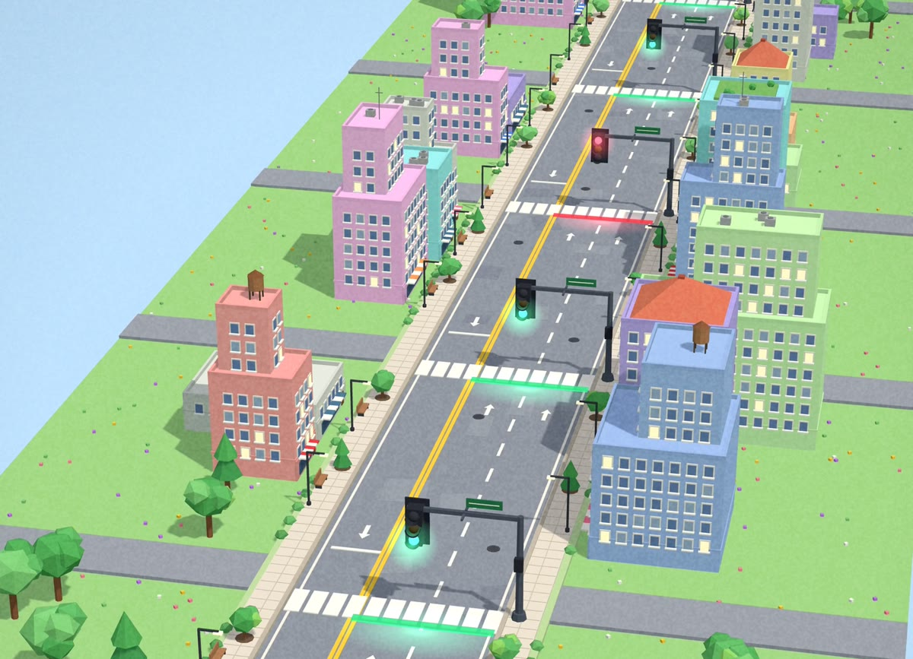
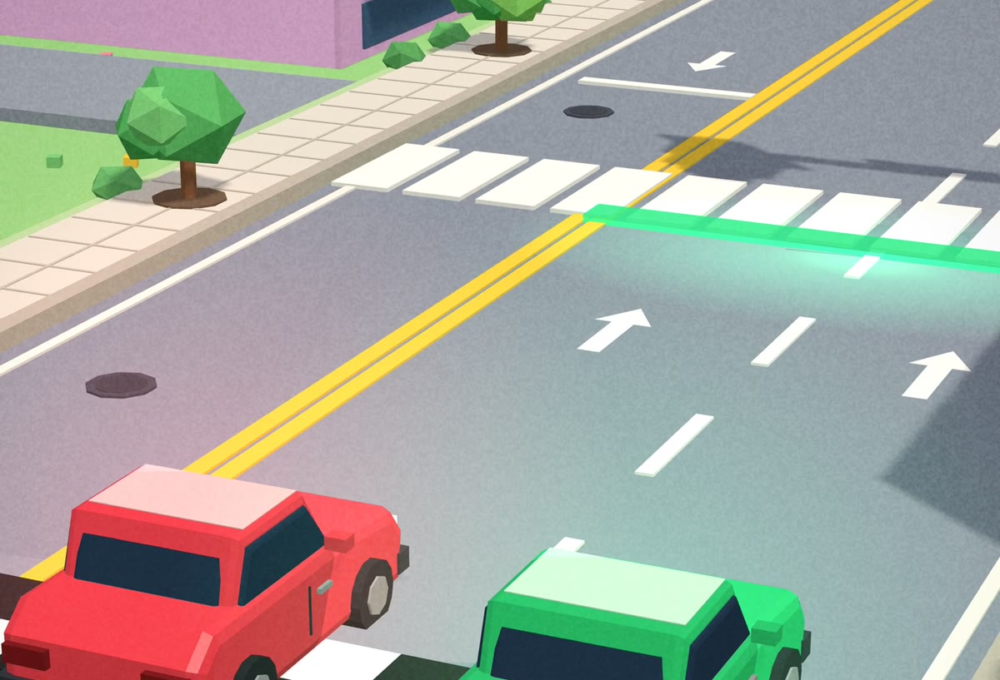
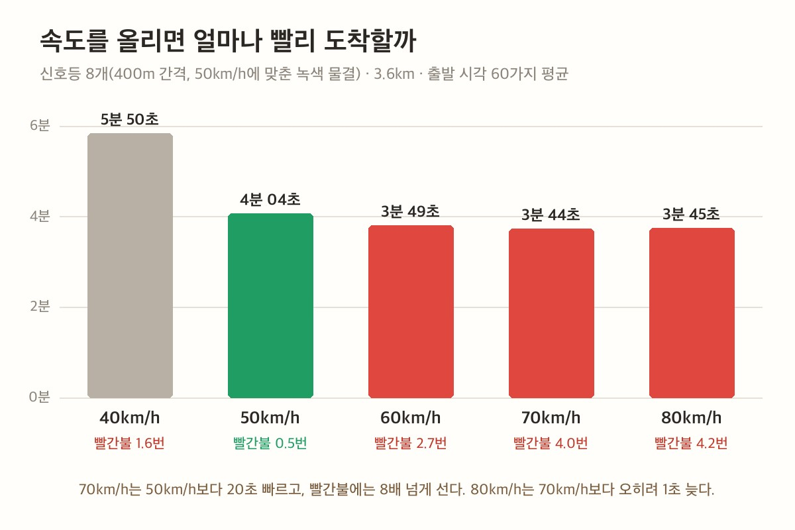

초록불이 켜지는 순간, 옆 차선에서 엔진 소리가 터졌다. 으르릉. 검은 차 한 대가 튕겨 나가듯 앞으로 사라졌다.

나도 모르게 발에 힘이 들어갔다. 뒤처진 것 같았다. 아니, 실제로 뒤처졌다. 그 차의 미등은 금세 점이 되었고, 나는 평소 속도 그대로였다. **이상하게 지는 기분이 들었다.**

그런데 두 번째 신호에서 빨간불에 걸려 섰을 때, 바로 옆에 그 검은 차가 서 있었다.

웃음이 났다. 저렇게 밟고 가서 결국 나랑 같은 자리네. 잠깐 통쾌했다. 그리고 곧 조금 민망해졌다. 방금 전까지 나도 따라 밟을까 망설였으니까.

신호가 바뀌자 그 차는 또 튀어 나갔다. 나는 다시 천천히 출발했다. 그리고 궁금해졌다. **그 차는 결국, 나보다 얼마나 먼저 도착했을까.**

---

### 신호등 여덟 개짜리 경주

컴퓨터 속에 곧은 대로 하나를 깔았다. 400m마다 신호등이 있고, 모두 여덟 개다. 이 신호들은 **녹색 물결**(신호 연동)로 맞춰 두었다. 시속 50km로 달리는 차가 첫 초록불을 받으면, 다음 신호도, 그다음 신호도 도착할 때마다 초록불이 되도록 켜지는 시간을 조금씩 늦춘 것이다.

그리고 두 차를 같은 순간에 출발시켰다. 빨간 차는 시속 70km, 초록 차는 시속 50km. 출발 시각을 60가지로 바꿔 가며 평균을 냈다.

여기서 잠깐 골라 보자. 3.6km를 달려 결승선에 닿았을 때, 시속 70km 차는

- A. 1분 넘게 먼저 도착한다
- B. 20초쯤 먼저 도착한다
- C. 오히려 늦게 도착한다

나는 A라고 생각했다. 시속 20km나 빠르니까. 신호가 없다면 실제로 1분 넘게 빨라야 하는 거리다.

결과는 B였다. 빨간 차는 평균 **3분 44초**, 초록 차는 **4분 04초**. 차이는 겨우 **20초**였다.

빨간 차는 달리고, 서고, 또 달렸다. 빨간불에 평균 **4번** 섰다. 초록 차는 0.5번. 출발할 때 운 나쁘게 한 번 걸리는 정도였다. 단순한 계산식으로 따져 본 기름값은 빨간 차가 **79%** 더 들었다.

속도를 더 올려 봐도 마찬가지였다. 시속 80km로 달린 차는 시속 70km 차보다 오히려 1초 늦었다.

이유는 이랬다. **녹색 물결 위에서 빠른 차는 초록불을 앞질러 간다.** 다음 신호에 너무 일찍 도착해서, 아직 켜지지 않은 초록불을 빨간불 앞에서 기다린다. 결국 빨리 달린 시간을 정지선에서 거의 다 돌려준다. 그 사이 초록 차는 한 번도 서지 않고 물결을 탄다. 브레이크도, 다시 밟는 가속도 없다.

신호를 이렇게 맞추는 방법은 1960년대 교통 공학자들이 정리했다. 그리고 하나 더 놀라운 점이 있었다. 같은 신호를 **반대 방향**으로 달리면 시속 50km 차도 평균 3.5번 선다. 400m 간격에서는 물결이 한쪽 방향에만 맞기 때문이다. 양쪽이 다 맞으려면 신호 간격이 625m여야 했다.

@@ 신호 간격과 속도를 바꿔 가며, 녹색 물결이 생기고 깨지는 순간을 직접 보자. | 녹색 물결 신호 실험, 직접 돌려 보기 | https://simulatiolab.com/greenwave

---

### 뛰어서 같은 열차를 타는 아침

이 장면은 도로 밖에서도 자주 본다.

환승역 계단. 열차 들어오는 소리가 들리면 사람들이 뛰기 시작한다. 나도 뛴다. 숨을 몰아쉬며 승강장에 닿으면, 문이 닫힌 열차가 막 떠나고 있다. 그리고 몇 분 뒤 다음 열차가 온다. **걸어서 내려온 사람도 같은 열차를 탄다.**

{{photo a | 아침 환승역, 막 떠나는 열차와 숨을 고르는 사람의 뒷모습 | Photorealistic photo of a subway platform in Seoul during morning rush hour, a train pulling away with slight motion blur, one commuter seen from behind catching their breath with a hand on their knee, other commuters walking calmly down the stairs in the background, faces not identifiable, no logos, no readable signs or text}}

열차에는 시간표가 있고, 신호에는 주기가 있다. 세상의 많은 일이 그렇게 자기 박자로 돌아간다. 내가 그 박자보다 빨리 도착하면, 아낀 시간은 기다림으로 바뀐다. 그 대신 숨이 차고, 땀이 나고, 마음이 조급해진다. 차로 치면 브레이크와 가속에 쓴 기름이다.

일도 비슷하다. 오전에 보고서를 서둘러 끝내 보내도, 결재하는 사람이 오후에 몰아서 본다면 그 서두름은 받은 편지함에서 기다린다. 서두르는 게 나쁘다는 말이 아니다. **서두르기 전에, 상대의 박자를 먼저 보면 된다.**

---

다음 날 아침, 같은 길에서 일부러 시속 50km를 지켜 봤다.

{{photo b | 아침 대로, 앞쪽으로 초록 신호등이 줄지어 켜진 길 | Photorealistic photo from a driver's point of view on a wide straight city avenue in the morning, a long row of traffic lights ahead all showing green one after another, light traffic, fresh and calm mood, no readable license plates, no logos, no readable signs or text}}

초록불이 하나 켜지고, 그다음이 켜지고, 또 그다음이 켜졌다. 나는 한 번도 브레이크를 밟지 않았다. 세 번째 신호쯤에서, 빨간불 앞에 서 있는 검은 차 한 대를 천천히 지나쳤다.

그날 나는 그 차보다 20초쯤 늦게 도착했을 것이다. 그런데 이상하게, 하나도 지는 기분이 아니었다.

{{photo c | 아침 햇빛 속 조용한 교차로, 정지선 앞에 선 차 한 대 | Photorealistic photo of a quiet city intersection in soft morning light, a single car stopped at the stop line under a red traffic light while the road beyond is empty, calm mood, no readable license plates, no logos, no readable signs or text}}

%% 오늘의 인사이트
- **서두르기 전에 아끼는 시간부터 계산하자.** 신호등 여덟 개짜리 3.6km에서 과속으로 아낀 시간은 20초였다. 그 20초를 위해 쓴 기름, 브레이크, 긴장이 그만한 값어치가 있는지 한 번만 따져 보자.
- **속도보다 박자.** 신호의 주기, 열차 시간표, 상대가 메일을 확인하는 시간. 일이 돌아가는 박자를 알면 덜 서두르고도 같은 시각에 도착한다.
- **내 박자가 모두에게 맞지는 않는다.** 한 방향에 딱 맞춘 녹색 물결은 반대 방향에선 빨간불의 연속이었다. 팀의 일정을 짤 때, 내게 편한 흐름이 반대편 사람에게는 매번 멈춤일 수 있다는 걸 기억하자.

여러분은 출퇴근길에 "밟아도 결국 같은 신호에서 만나는 차"를 본 적 있나요? 자주 다니는 길의 신호 이야기를 댓글로 들려주세요.

~~ 덧붙임. 글 속의 숫자는 사이트 시뮬레이션 모델 결과다(신호 8개, 간격 400m, 주기 90초·녹색 45초, 설계 속도 50km/h, 신호 앞뒤 200m 포함 3.6km, 차 한 대씩 따로 달리며 다른 차·회전 차량·보행 신호는 없음, 출발 시각 60가지 평균). 연료는 이 프로젝트의 단순한 계산식으로 낸 추정치이며 실제 차종의 연비가 아니다. 실제 도로에서 과속은 사고 위험과 단속 대상이라는 점도 함께 기억하자. 신호 연동의 고전 연구: J. D. C. Little (1966), "The Synchronization of Traffic Signals by Mixed-Integer Linear Programming", Operations Research 14(4). 그림은 직접 만든 3D 시뮬레이션 화면과 그래프이며, 글 정리에 AI(Claude)의 도움을 받았다.
