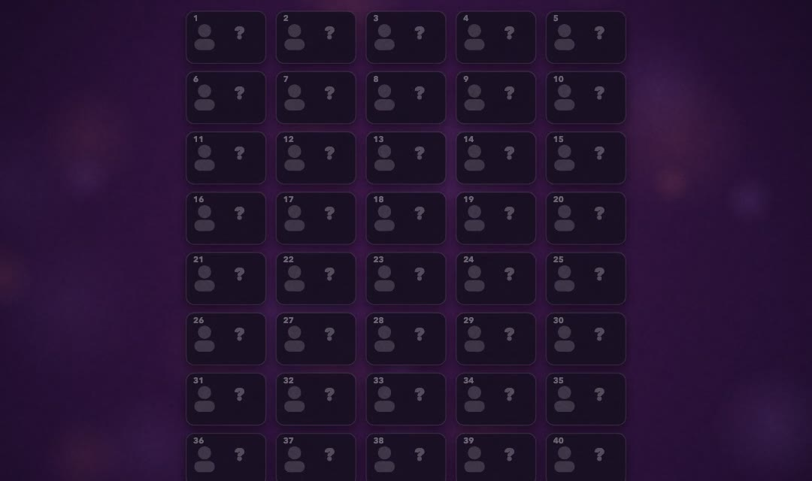
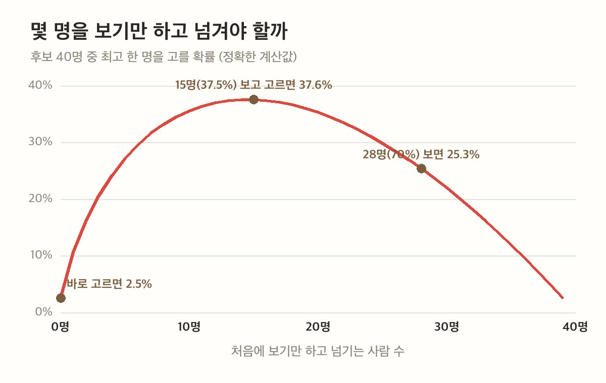
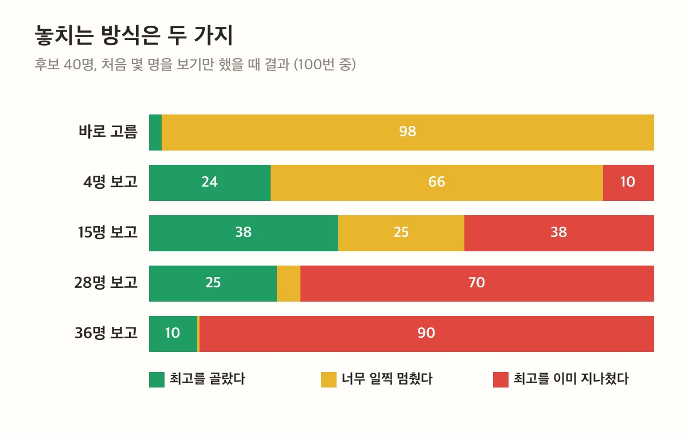

중개사님의 열쇠 꾸러미가 짤랑거린다. 오늘 보는 집만 벌써 네 번째. 신발을 벗고 들어서자 오후 햇빛이 거실 바닥에 길게 누워 있다. 창밖으로 나무가 보인다. 마음이 먼저 "여기다" 하고 말한다.

그런데 입은 다르게 말한다. "조금만 더 보고 연락드릴게요." 이사 날짜까지는 아직 여유가 있으니까. 더 좋은 집이 있을지도 모르니까.

{{photo a | 오후 햇빛이 길게 들어오는 빈 거실 | Photorealistic photo of an empty Korean apartment living room in the afternoon, warm sunlight stretching across the wooden floor, a large window with green trees outside, no furniture, calm and inviting mood, no people, no logos, no readable text}}

다음 날 전화가 온다. 그 집, 어제저녁에 계약됐다고. 그 뒤로 본 집들은 이상하게 다 그 집만 못하다. 창이 작거나, 해가 안 들거나, 둘 다거나. **결국 시간에 쫓겨 처음 본 집보다 못한 집에 도장을 찍는다.**

반대의 후회도 있다. 너무 지쳐서, 처음 마음에 든 집에 덜컥 계약하고 나면 한 달 뒤 더 싸고 넓은 집이 눈에 들어온다. 조금만 더 볼걸.

기다리면 놓치고, 서두르면 아쉽다. **그럼 대체 언제 "여기다"라고 말해야 할까.** 그 물음이 이사를 마친 뒤에도 한참 남았다.

---

### 되돌릴 수 없는 줄

이 물음을 아주 단순하게 줄여 보았다.

후보 40명이 한 명씩, 무작위 순서로 온다. 집이어도, 면접자여도 좋다. 만나는 순간에는 지금까지 본 후보들과 비교만 할 수 있다. 그리고 한 번 보낸 후보는 다시 부를 수 없다. 목표는 단 하나, **40명 중 최고를 고르는 것.**

전략은 이렇게 정했다. 처음 몇 명은 무조건 보기만 하고 보낸다. 기준을 잡는 시간이다. 그다음부터는 "지금까지 본 모두보다 나은" 첫 후보가 나타나면 바로 고른다.

여기서 잠깐 골라 보자. 최고를 고를 확률이 가장 높으려면, 처음 몇 명을 그냥 보내야 할까.

- A. 0명. 마음에 들면 바로
- B. 15명쯤
- C. 30명쯤. 충분히 본 뒤에

나는 A와 B 사이 어딘가라고 생각했다. 마음에 드는 집을 보내는 게 얼마나 아까운지 아니까.

---

### 37%에서 멈춰라

결과는 이랬다.

- 처음 마음에 든 후보를 바로 고르면, 최고일 확률 **2.5%**.
- 15명을 보기만 하고 그 뒤 기준을 넘는 첫 후보를 고르면 **37.6%**.
- 28명까지 지켜보다 고르면 다시 **25.3%**로 떨어진다.

바로 고르는 것보다 열다섯 배 낫다. 40명 중 15명, **딱 37.5% 지점이 꼭대기**였다.

왜 하필 그쯤일까. 실패를 뜯어보니 두 종류였다.

하나는 **너무 일찍 멈추는 실패.** 기준이 없으니 그저 괜찮은 후보에게 "여기다"라고 말해 버린다. 다른 하나는 **이미 지나쳐 버린 실패.** 오래 지켜보는 사이 최고가 이미 지나가 버리고, 그 뒤엔 누구도 기준을 넘지 못한다.

바로 고르면 거의 언제나 너무 일찍 멈춘다. 오래 지켜보면 열에 일곱은 이미 지나쳐 있다. 15명쯤에서 두 실패를 합친 몫이 가장 작아지고, 최고를 고르는 몫이 가장 커진다. 후보가 100명이든 1,000명이든 그 지점은 거의 같았다. **약 37%. 수학에서는 1/e이라고 부르는 숫자다.**

이 문제에는 오래된 이름이 있다. 비서 문제(최적 멈춤 문제). 1960년 마틴 가드너의 잡지 칼럼으로 널리 알려졌고, 이듬해 통계학자 데니스 린들리가 답을 정리했다.

@@ 후보 수와 보기만 하는 비율을 바꿔 가며, 언제 고를지 직접 정해 보자. | 37% 법칙 실험, 직접 돌려 보기 | https://simulatiolab.com/secretary

---

### 내 이사에 대어 보면

그 집 구하기에 이 숫자를 대어 보았다.

이사까지 집을 볼 시간이 4주였다면, 37%는 열흘쯤이다. 처음 열흘은 계약할 생각 없이 마음껏 본다. 대신 집마다 메모한다. 해는 드는지, 창밖은 어떤지, 이 값이면 어느 정도인지. **그 열흘이 내 기준을 만든다.** 열하루째부터는 그 기준을 넘는 첫 집에서 망설이지 않는다.

그렇게 보면, 내가 놓친 그 햇빛 좋은 집은 넷째 날에 왔다. 기준이 없던 나에게는 "이게 최고인지" 알 방법이 없었다. 반대로 지쳐서 덜컥 계약한 집은, 기준 없이 일찍 멈춘 실패였다. **두 후회는 서로 반대처럼 보였지만, 사실 같은 지도 위의 양쪽 끝이었다.**

{{photo b | 부동산 매물 메모가 적힌 수첩과 열쇠 | Photorealistic close-up photo of an open paper notebook with handwritten notes and small hand-drawn floor plan sketches, a set of keys and a pen resting on it, on a wooden table near a window, soft daylight, handwriting blurred and unreadable, no logos}}

연애에도 이 법칙이 자주 인용된다. 하지만 사람은 순서대로 한 명씩 오지도 않고, 보낸 사람이 다시 돌아오기도 하며, 상대도 나를 고른다. 그래서 이 숫자는 연애 처방이라기보다, **"기준을 만드는 시간"과 "결정하는 시간"을 나눠 보라는 생각의 틀** 정도로 받아들이는 게 좋다.

---

37.6%라는 숫자도 다시 보게 된다. 가장 좋은 전략인데도, 열 번 중 여섯 번은 최고를 놓친다. 그러니 놓친 집 하나로 나를 너무 탓할 일은 아니었다. 최선을 다해 고른 사람도 대개는 최고를 놓친다.

다음 이사철이 오면 나는 휴대폰 메모장에 날짜 하나를 적어 둘 것이다. 기준 마감일. 그날까지는 보기만 한다. 그다음, 기준을 넘는 첫 집의 거실에 햇빛이 길게 누워 있다면 이번엔 이렇게 말할 생각이다.

"여기로 할게요."

{{photo c | 새 집 현관에서 열쇠를 건네받는 손 | Photorealistic close-up photo of one hand passing a door key to another hand at the entrance of an apartment, soft hallway light, shallow depth of field, hopeful mood, faces not visible, no logos, no readable text}}

%% 오늘의 인사이트
- **결정 전에 "기준 마감일"을 정하자.** 쓸 수 있는 기간의 3분의 1 남짓은 고르지 말고 보기만 하며 기준을 만든다. 그다음엔 그 기준을 넘는 첫 후보에서 멈춘다.
- **최고가 아니라 "꽤 좋은" 것이면 충분하다면, 덜 보고 정하자.** 같은 40명에서 상위 3명 안에만 들면 된다고 목표를 바꾸면, 10명(25%)만 보고 고를 때 성공 확률이 62%로 가장 높았다. 욕심을 낮추면 관찰 기간도 짧아진다.
- **되돌릴 수 있는 선택에는 이 법칙을 쓰지 말자.** 37%는 "한 번 보내면 끝"일 때의 숫자다. 다시 돌아가 살 수 있는 옷이나, 비교표를 한 번에 펼쳐 볼 수 있는 물건이라면 다 보고 고르는 편이 낫다.

여러분은 "조금만 더 볼걸" 쪽인가요, "그때 잡을걸" 쪽인가요? 가장 아까웠던 선택을 댓글로 들려주세요.

~~ 덧붙임. 글 속의 숫자는 사이트 모델로 계산한 값이다(후보 40명, 무작위 순서, 비교만 가능하고 되돌릴 수 없음, 목표는 최고 한 명. 확률은 정확한 식으로 계산했고 10만 번 시뮬레이션과도 맞음). 끝까지 기준을 넘는 후보가 없으면 마지막 후보를 받는다고 두었다. 후보가 많아질수록 최적 비율은 1/e(약 36.8%)에 가까워진다. 실제 집·사람 고르기의 기록이 아니다. 근거: D. V. Lindley (1961), "Dynamic Programming and Decision Theory", Applied Statistics 10(1). 문제가 처음 널리 소개된 것은 Martin Gardner, Scientific American "Mathematical Games"(1960년 2월호)이며, 누가 먼저 풀었는지에 대한 역사는 T. S. Ferguson (1989), "Who Solved the Secretary Problem?", Statistical Science 4(3)에 정리되어 있다. 그림은 직접 만든 시뮬레이션 화면과 그래프이며, 글 정리에 AI(Claude)의 도움을 받았다.
