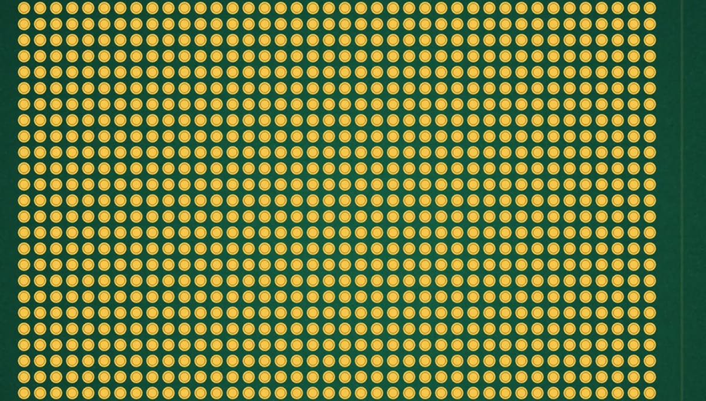
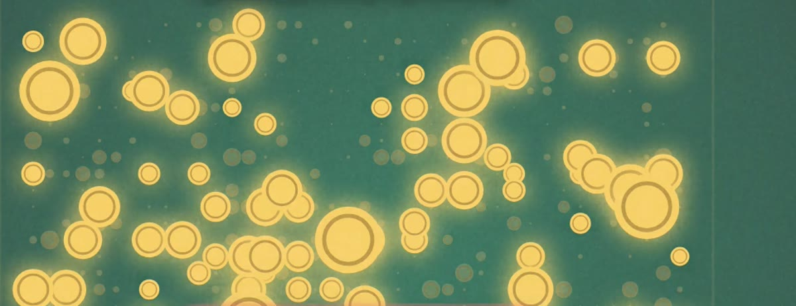
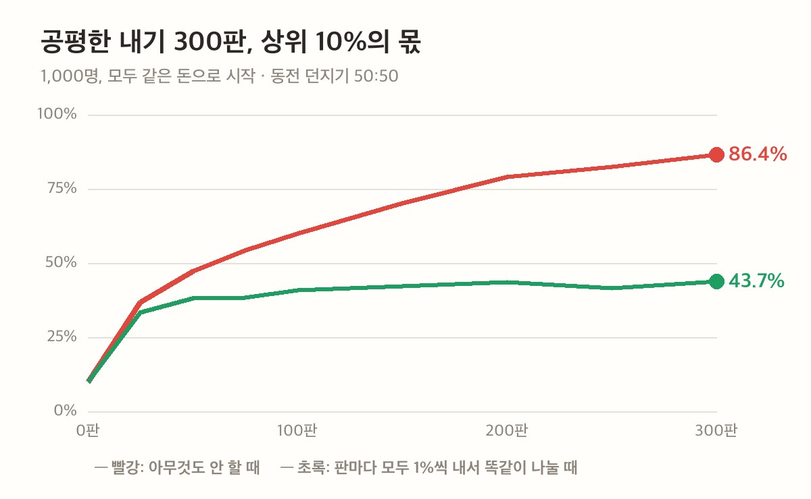

휴대폰이 짧게 울린다. 단톡방이다. 대학 동기 한 명이 새 아파트 거실 사진을 올렸다. 통창 너머로 강이 보인다. 축하한다는 말이 줄줄이 달린다. 나도 엄지 이모티콘 하나를 보탠다.

화면을 끄고 나서야 마음이 조금 이상해진다. 같은 해에 졸업했고, 비슷한 회사에 들어갔고, 첫 월급도 거의 같았다. 둘 다 성실했다. 그런데 십 년 뒤 우리 사이에는 강 하나만큼의 거리가 생겼다.

{{photo a | 밤에 켜진 휴대폰 화면 불빛, 어두운 방 | Photorealistic photo of a smartphone lying face up on a bedside table in a dark room at night, its screen glowing softly and lighting up the surroundings, the screen content blurred and unreadable, a cup of tea nearby, quiet and slightly lonely mood, no people, no logos, no readable text}}

처음엔 부러움이었다. 그다음엔 계산이 시작된다. 나는 어디서 잘못 골랐을까. 그때 그 주식을 샀어야 했나, 그 동네로 이사했어야 했나. **계산은 늘 같은 결론으로 끝난다. 내가 뭔가 모자랐던 거다.**

그런데 그날 밤 문득 다른 질문이 떠올랐다. 만약 둘 다 아무 실수도 하지 않았다면? 똑같이 출발해서, 똑같이 공평한 기회만 주고받았다면, 우리는 지금 비슷한 곳에 서 있었을까.

---

### 동전 한 닢씩 들고 시작한 1,000명

이 질문을 시험해 보려고, 컴퓨터 속에 1,000명이 사는 작은 시장을 만들었다.

모두 똑같은 돈으로 시작한다. 그리고 할 수 있는 건 단 하나, 내기다. 무작위로 두 사람이 만나 동전을 던진다. 판돈은 둘 중 가난한 사람이 가진 돈의 20%. 가난한 쪽이 한 번에 파산하지 않게 하는 배려다. **속임수도, 재능 차이도, 물려받은 재산도 없다. 확률은 정확히 반반이다.**

한 판에 1,000번씩 거래하고, 300판을 돌렸다.

여기서 잠깐 골라 보자. 300판 뒤, 가장 부유한 상위 10%가 가진 돈은 전체의 몇 %일까.

- A. 20% 안팎. 공평하니까 크게 벌어지지 않는다
- B. 50% 안팎. 조금은 쏠린다
- C. 80% 넘게

나는 A라고 생각했다. 매번 공평한 동전인데, 벌어져 봐야 얼마나 벌어지겠나.

---

### 공평한 동전이 만든 쏠림

결과는 C였다. 상위 10%가 전체 돈의 **86.4%**를 가졌다. 아래쪽 절반 500명이 가진 돈은 다 합쳐도 **0.0%**, 반올림하면 사라지는 수준이었다. 가장 부자인 한 사람은 평균의 **28.9배**를 가졌다.

더 이상한 숫자도 있었다. 1,000명 중 **849명**은 처음보다 가난해졌다. 공평한 내기를 300판 했는데, 열 명 중 여덟 명 넘게가 잃은 것이다.

나는 이 결과가 믿기지 않아 같은 실험을 다른 난수로 다섯 번 더 돌렸다. 매번 거의 같았다.

이유는 판돈이 "비율"이라는 데 있었다. 내 돈의 20%를 따고, 다음 판에 20%를 잃었다고 해 보자. 한 번 이기고 한 번 졌으니 본전 같지만, 계산해 보면 1.2 × 0.8 = 0.96. **4%가 사라진다.** 이기고 지기를 공평하게 반복할수록, 돈은 조금씩 새어 나간다.

그런데 그 새는 속도가 모두에게 같지 않다. 초반에 운 좋게 몇 번 연달아 이긴 사람은 몸집이 커져서, 웬만큼 져도 버틴다. 반대로 초반에 몇 번 진 사람은 판돈이 점점 작아져서, 이겨도 되찾는 돈이 작다. **운은 공평하게 나뉘었지만, 운의 결과는 쌓였다.** 과학자들은 이것을 '야드세일 모델'이라고 부른다.

그래서 규칙을 하나만 더해 보았다. 한 판이 끝날 때마다 모두가 가진 돈의 1%씩 내서, 똑같이 나눠 갖기. 그러자 300판 뒤 상위 10%의 몫은 **43.7%**에서 멈췄고, 아래쪽 절반도 12.0%를 지켰다. 아주 작은 나눔이 쏠림의 바퀴에 브레이크를 걸었다.

@@ 판돈 비율과 나눔 비율을 바꿔 가며, 돈이 어디로 흘러가는지 직접 보자. | 공평한 내기의 부의 쏠림 실험, 직접 돌려 보기 | https://simulatiolab.com/wealth

---

### 첫 번째 동전의 무게

이 실험을 보고 나서, 회사에서 자주 보던 장면이 달리 보였다.

같은 해 들어온 신입 두 명. 한 명은 처음 맡은 일이 우연히 잘 풀렸다. 그러자 다음에 더 큰 일이 왔고, 큰 일을 해 본 사람이라는 이유로 그다음 기회가 또 왔다. 다른 한 명은 처음 맡은 일이 엎어졌다. 실력 탓이 아니라 거래처 사정이었다. 그 뒤로는 작은 일만 왔다. **작은 일에서는 아무리 잘해도, 되찾을 수 있는 것이 작다.**

{{photo b | 사무실 책상 위, 큰 서류 더미와 얇은 서류 한 장이 나란히 놓인 모습 | Photorealistic photo of two neighboring office desks seen from above, one desk covered with a tall stack of project folders and a laptop, the other desk with only a single thin folder, soft daylight from a window, no people, no logos, no readable text}}

십 년 뒤 두 사람 사이의 거리는, 각자의 노력만으로는 설명이 안 된다. 첫 동전이 어느 쪽으로 떨어졌는지가 생각보다 오래, 생각보다 크게 남는다.

---

그날 밤의 계산을 다시 해 본다. 나는 정말 뭔가 모자랐던 걸까.

어쩌면 아닐 수도 있다. 똑같이 성실하고 똑같이 공평한 기회를 받아도, 결과는 강 하나만큼 벌어질 수 있다. 그건 내 친구가 특별히 영리해서도, 내가 특별히 어리석어서도 아니었다. 그렇다고 친구의 노력을 깎아내릴 이유도 없다. 다만 내 몫의 자책은 조금 내려놓아도 될 것 같다.

그리고 대신, 다른 질문 하나를 오래 들고 있으려 한다.

> 내가 받은 운은, 지금 어디에 쌓여 있는가?

%% 오늘의 인사이트
- **잃는 돈은 따는 돈보다 무겁다.** 20% 벌고 20% 잃으면 본전이 아니라 4% 손해다. 투자든 도전이든 "크게 잃지 않는 것"이 "크게 따는 것"보다 먼저다.
- **초반의 운은 복리로 불어난다.** 첫 기회, 첫 결과가 그다음 판의 크기를 정한다. 그러니 남의 결과를 볼 때는 "얼마나 잘했나"와 함께 "첫 동전이 어디로 떨어졌나"도 같이 보자. 나를 볼 때도 마찬가지다.
- **작은 나눔이 큰 쏠림을 막는다.** 판마다 1%만 나눠도 쏠림이 절반으로 줄었다. 팀의 기회를 돌아가며 맡기기, 후배에게 큰 일 한 번 넘겨 주기. 내가 가진 운의 1%를 흘려보내는 방법은 생각보다 많다.

여러분 주변에도 "첫 동전" 하나로 갈린 이야기가 있나요? 댓글로 들려주세요.

~~ 덧붙임. 글 속의 숫자는 사이트 시뮬레이션 모델 결과다(1,000명, 모두 같은 돈으로 시작, 판돈은 가난한 쪽 재산의 20%, 동전 확률 정확히 50:50, 한 판에 1,000번 거래, 300판, 시드 1. 다른 시드 5개도 불평등 지수(지니계수) 0.90으로 같았다). 실제 경제는 재능·노력·상속·제도가 모두 섞여 있으며, 이 모델은 "공평한 규칙만으로도 쏠림이 생길 수 있다"는 점만 보여 준다. 근거: A. Chakraborti (2002), "Distributions of money in model markets of economy", International Journal of Modern Physics C 13(10) · B. Hayes (2002), "Follow the Money", American Scientist('야드세일 모델'이라는 이름) · B. M. Boghosian (2019), Scientific American 11월호. 그림은 직접 만든 시뮬레이션 화면과 그래프이며, 글 정리에 AI(Claude)의 도움을 받았다.
