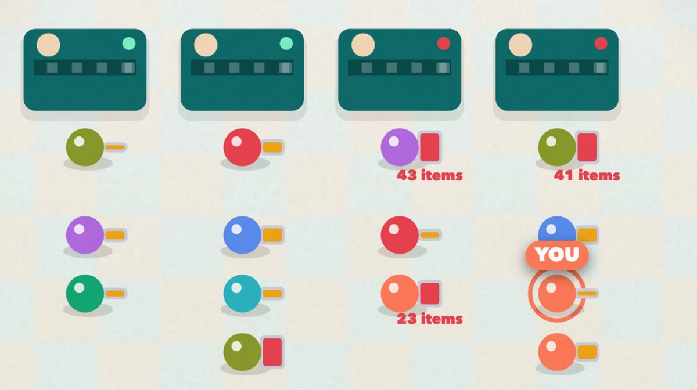
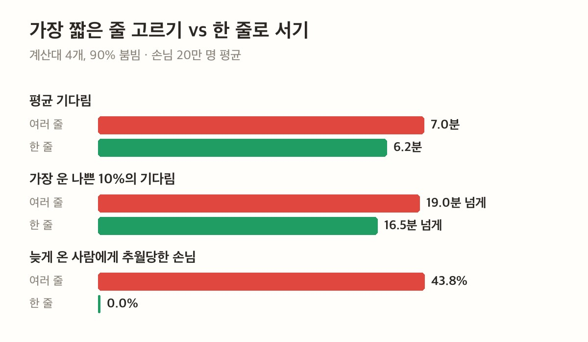
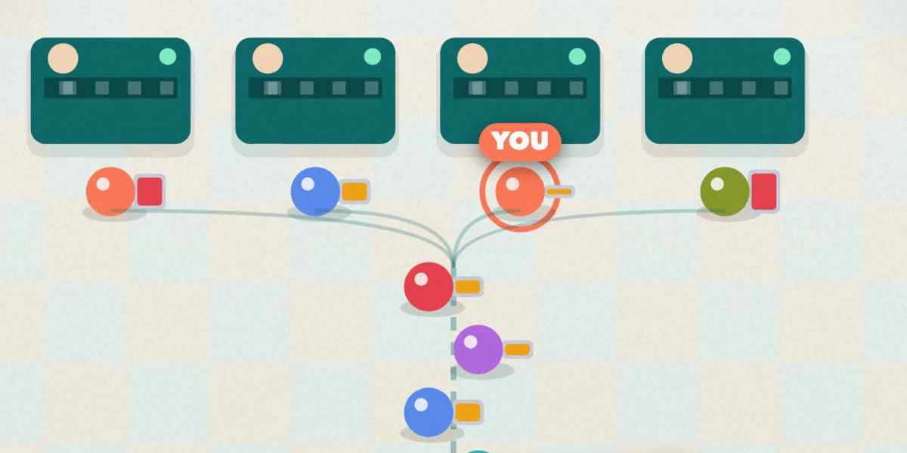

주말 저녁의 마트. 카트 바퀴 하나가 덜컹거린다. 계산대 네 곳에 줄이 다 길다. 나는 재빨리 눈으로 센다. 세 명, 네 명, 다섯 명, 네 명. 가장 짧은 줄로 카트를 민다.

옆 줄 맨 뒤에 비슷한 때 도착한 사람이 선다. 말은 안 했지만, 우리는 이미 경주를 시작했다.

{{photo a | 주말 저녁 마트, 계산대마다 늘어선 줄과 카트 | Photorealistic photo of a busy supermarket at night on a weekend, several checkout lanes each with a line of shoppers and full shopping carts, seen from behind the lines, bright fluorescent light, slight motion blur, faces not identifiable, no logos, no readable signs or prices}}

처음 몇 분은 괜찮았다. 그러다 내 앞 손님의 카드가 두 번 연속 오류가 난다. 그 앞 손님은 영수증을 다시 확인한다. 옆 줄은 쑥쑥 줄어든다. 결국 옆 줄의 그 사람이 봉투를 들고 나가는 뒷모습을 본다. 내 앞에는 아직 두 명이 있다.

**억울함은 늘 이 순간에 온다. 나는 왜 맨날 느린 줄을 고를까.**

줄을 옮길까 망설이다가, 옮기는 순간 이 줄이 빨라질 것 같아서 그대로 선다. 이 작은 도박은 장 볼 때마다 반복된다. 늘 지는 쪽은 나인 것 같다. 정말 내가 운이 없는 걸까, 아니면 처음부터 질 수밖에 없는 게임일까.

---

### 계산대 네 개짜리 가게

컴퓨터 속에 계산대 네 개짜리 가게를 열었다. 손님은 들쑥날쑥 도착하고, 계산 시간도 사람마다 다르다. 우유 하나만 든 사람도 있고, 카트를 꽉 채운 사람도 있다. 평균은 한 명에 3분. 계산대는 90% 시간 동안 바쁘다. 주말 저녁쯤이다.

손님들은 모두 똑똑하게 행동한다. **도착하면 그 순간 가장 짧은 줄에 선다.** 그리고 손님 20만 명의 기다림을 쟀다.

결과부터 보면, 손님의 **43.8%**가 자기보다 늦게 온 사람이 먼저 계산을 끝내는 걸 겪었다. 가장 짧은 줄을 골랐는데도 열 명 중 네 명 넘게가 추월당한 것이다. 내 억울함은 나만의 것이 아니었다.

그래서 줄 서는 방식을 하나 바꿔 봤다. 줄을 네 개로 나누지 않고, **하나로 길게 세운다.** 계산대가 비면 맨 앞사람이 그곳으로 간다. 은행 번호표와 같은 방식이다.

여기서 잠깐 골라 보자. 한 줄로 서면 평균 기다림은 어떻게 될까.

- A. 더 길어진다. 줄이 저렇게 길어 보이는데
- B. 별 차이 없다. 계산대 수는 똑같으니까
- C. 짧아진다

나는 B라고 생각했다. 계산하는 사람이 늘지도 줄지도 않았으니까.

---

### 한 줄이 이기는 이유

결과는 C였다. 평균 기다림이 **7.0분에서 6.2분**으로 줄었다. 가장 운 나쁜 10%의 기다림도 19.0분 넘게에서 16.5분 넘게로 줄었다. 그리고 늦게 온 사람에게 추월당한 손님은 **0%**. 한 명도 없었다.

이유는 느린 손님 한 명에게 있었다. 줄이 넷이면, 카트를 꽉 채운 손님이나 카드 오류 한 번이 **그 줄 전체를 멈춰 세운다.** 그 사이 옆 계산대는 손님이 다 빠져서 잠깐 놀기도 한다. 모델에서 이렇게 "한쪽은 기다리는데 다른 계산대는 노는" 시간이 전체의 11.7%였다.

한 줄에서는 이런 일이 생기지 않는다. 느린 손님이 계산대 하나를 붙잡고 있어도, 다음 사람은 비어 있는 다른 계산대로 간다. **나쁜 운이 한 줄에 몰리지 않고, 모두에게 조금씩 나뉜다.**

이 계산의 뿌리는 뜻밖에도 전화다. 1909년 덴마크의 전화 회사 기술자 아그너 얼랑은, 교환대에 통화가 몰릴 때 사람들이 얼마나 기다리는지 계산했다. 통화를 손님으로, 교환 회선을 계산대로 바꾸면 똑같은 문제다. 이렇게 시작된 학문이 '대기행렬 이론'이다.

@@ 계산대 수와 붐비는 정도를 바꿔 가며, 줄을 하나로 설 때와 나눠 설 때를 직접 비교해 보자. | 마트 계산대 줄 서기 실험, 직접 돌려 보기 | https://simulatiolab.com/checkout

물론 여러 줄에서 운이 좋았던 손님도 있다. 같은 손님을 두 방식으로 비교하면, 여러 줄에서 1분 넘게 덜 기다린 사람이 26%, 1분 넘게 더 기다린 사람이 34%였다. 여러 줄은 이길 때도 있는 도박이다. 다만 평균적으로는 지는 쪽에 걸게 된다.

---

### 번호표 앞의 평화

은행이나 구청에서 번호표를 뽑을 때를 떠올려 보자. 대기 인원 열두 명. 화면 숫자가 하나씩 올라가는 동안 사람들은 의자에 앉아 휴대폰을 본다. 어느 창구가 빠를지 눈치 보는 사람이 없다. 옮겨 갈 줄도 없다.

{{photo b | 은행 대기석, 번호표를 손에 쥐고 기다리는 모습 | Photorealistic close-up photo of a hand holding a small paper queue ticket in a bank waiting area, rows of waiting chairs softly blurred in the background, calm daylight, the number on the ticket blurred and unreadable, faces not visible, no logos, no readable text}}

기다리는 시간이 짧아서만이 아니다. **누구에게도 추월당하지 않는다는 확신이, 기다림을 덜 억울하게 만든다.** 마트의 여러 줄에서 우리를 지치게 하는 건 몇 분의 시간보다, 옆 줄을 힐끔거리며 계속 내 선택을 의심하는 마음이었다.

그래서 공항 수속 창구나 일부 매장은 일부러 줄을 하나로 모은다. 줄은 길어 보여도, 실제로 더 빨리 줄어든다.

---

다시 그 주말 저녁의 마트.

나는 여전히 가장 짧은 줄을 고른다. 그리고 여전히 가끔 옆 줄에 진다. 하지만 이제는 안다. 그건 내가 운이 없어서가 아니라, 나눠 선 줄이 원래 그렇게 생겼기 때문이라는 걸.

앞 손님의 카드가 또 오류가 난다. 나는 옆 줄을 보는 대신 장바구니 속 귤 봉지를 다시 정리한다. 언젠가 이 가게도 줄을 하나로 모으는 날이 오기를, 조금 웃으며 바라면서.

{{photo c | 장바구니 속 귤 봉지를 정리하는 손 | Photorealistic close-up photo of hands rearranging groceries in a shopping cart, a mesh bag of tangerines on top, warm supermarket light, calm and patient mood, faces not visible, no logos, no readable labels or text}}

%% 오늘의 인사이트
- **"내 줄만 느리다"는 기분은 착각이 아니라 구조다.** 가장 짧은 줄을 골라도 열 명 중 네 명은 추월당한다. 운이 나쁜 게 아니니, 옆 줄 대신 내 장바구니를 보자.
- **줄 길이보다 카트를 보자.** 사람 수보다 앞사람들의 물건 양이 기다림을 정한다. 모델에서도 줄 길이 대신 물건 수를 보고 고른 손님이 평균 6.6분으로 조금 더 빨랐다.
- **일을 나눌 때는 "한 줄"로.** 팀에서 담당자를 미리 나눠 맡기면 한 사람에게 일이 막혀도 다른 사람은 논다. 공용 할 일 목록에서 손이 빈 사람이 다음 일을 가져가는 방식이, 모두의 기다림을 줄인다.

여러분은 줄을 옮기는 편인가요, 끝까지 버티는 편인가요? 옮겼다가 후회한 이야기도 댓글로 들려주세요.

~~ 덧붙임. 글 속의 숫자는 사이트 시뮬레이션 모델 결과다(계산대 4개, 90% 붐빔, 손님은 무작위로 도착, 계산 시간 평균 3분·들쭉날쭉함 1, 손님은 도착 순간 가장 짧은 줄을 고르고 옮기지 않음, 같은 손님 목록에 두 방식을 똑같이 적용, 2만 명 × 10번 = 20만 명 평균. 이론값(한 줄)은 평균 5.9분). 실제 매장의 기록이 아니다. 근거: A. K. Erlang (1909), "The Theory of Probabilities and Telephone Conversations", Nyt Tidsskrift for Matematik B 20. 그림은 직접 만든 시뮬레이션 화면과 그래프이며, 글 정리에 AI(Claude)의 도움을 받았다.
