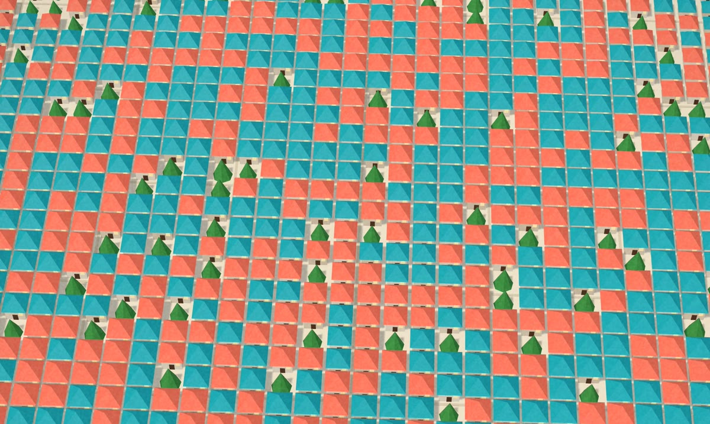
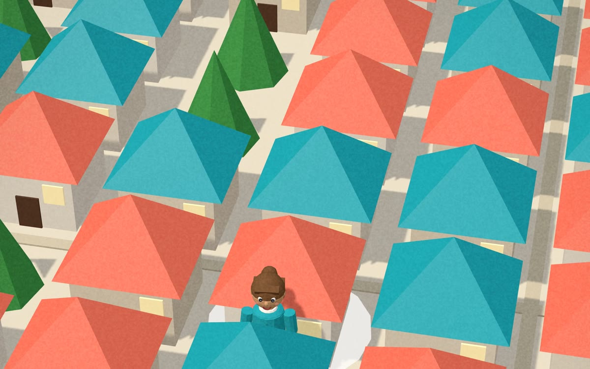
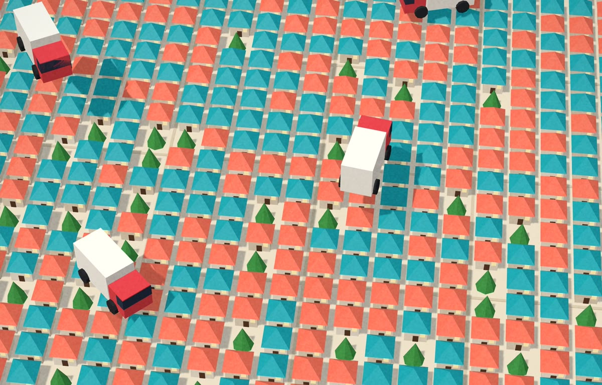
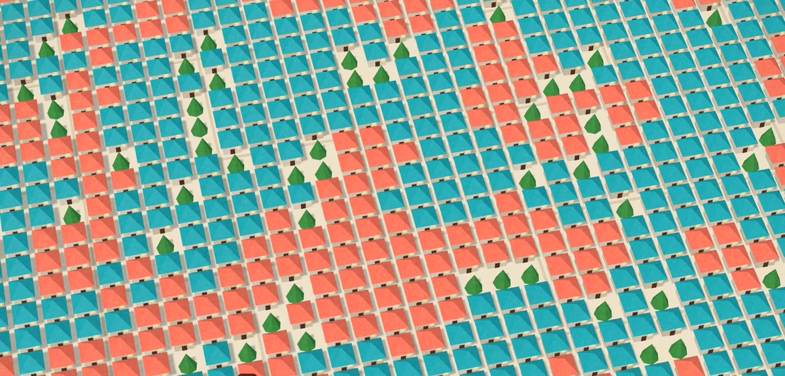
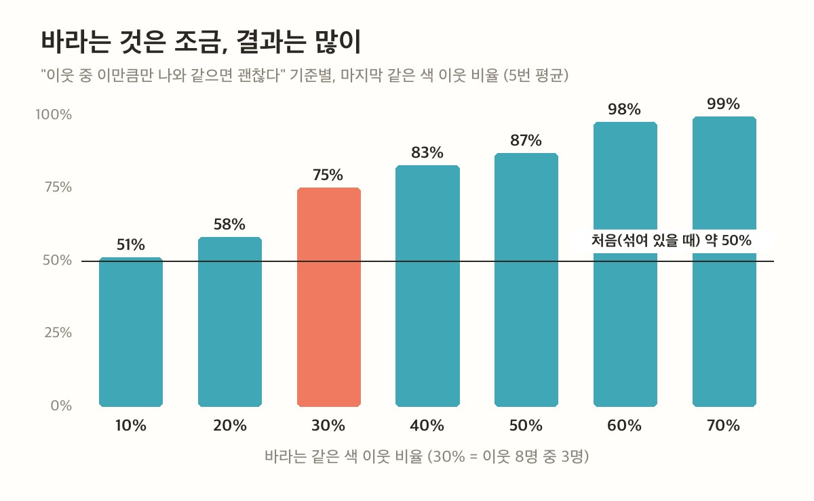

새 학기 첫날 급식실은 시끄럽다. 식판이 부딪히는 소리, 의자 끄는 소리. 그 소리 한가운데서 식판을 들고 서 있던 몇 초를, 누구나 한 번쯤 기억한다. 어디에 앉지.

그날은 아무 데나 앉았다. 처음 보는 얼굴들 사이에 끼어 앉아도 어색하지 않았다. 모두가 처음이었으니까.

{{photo a | 학기 초 급식실, 뒤섞여 앉은 학생들의 식판 | Photorealistic photo of a school cafeteria at lunchtime early in the semester, long tables with students sitting mixed together, food trays and spoons in the foreground, warm daylight from windows, lively mood, faces blurred and not identifiable, no logos, no readable text}}

그런데 몇 달이 지나면 풍경이 달라진다. 창가 테이블은 늘 그 무리, 가운데 테이블은 늘 저 무리. 누가 정한 것도 아닌데 자리가 굳는다. **식판을 들고 서 있으면, 이제는 앉을 수 있는 테이블과 앉기 애매한 테이블이 보인다.**

이상하게 조금 쓸쓸했다. 편을 가르자고 말한 사람은 아무도 없었다. 다들 그저 조금 편한 자리에 앉았을 뿐이다.

그 쓸쓸함은 어른이 되어서도 다른 모양으로 찾아왔다. 회사 구내식당에서, 아파트 단지에서, 휴대폰 속 피드에서. **아무도 원하지 않았는데, 왜 우리는 자꾸 끼리끼리 모이게 될까.**

---

### 너그러운 사람들의 마을

컴퓨터 속에 바둑판 같은 마을을 만들었다. 50×50칸에 집을 놓고, 두 색으로 칠했다. 청록 집과 주황 집이 반반, 아무렇게나 섞여 있다. 빈집도 10% 남겨 두었다.

사람들에게는 아주 너그러운 마음 하나만 주었다. "둘레 이웃 여덟 집 중 **세 집만** 나와 같은 색이면 충분해." 다시 말해, 이웃의 70%가 나와 달라도 괜찮은 사람들이다. 이 기준에 못 미치는 사람만 빈집으로 조용히 이사한다.

여기서 잠깐 골라 보자. 이렇게 너그러운 사람들의 마을은 어떻게 될까.

- A. 지금처럼 섞인 채로 남는다
- B. 조금 뭉치는 정도
- C. 뚜렷하게 두 덩어리로 갈라진다

나는 A라고 생각했다. 이웃의 70%가 달라도 괜찮다는데, 갈라질 이유가 없어 보였다.

처음 불만족한 사람은 **18%**였다. 그들이 이사를 시작했다.

딱 10번의 이사 끝에 마을은 멈췄다. 모두가 만족했다. 그런데 지도를 보고 나는 한참 말이 없었다. 처음 **50%**쯤이던 같은 색 이웃 비율이 **75%**가 되어 있었다. 마을은 청록 동네와 주황 동네로 뚜렷하게 갈라져 있었다. 답은 C였다.

---

### 작은 불편함의 연쇄

이유는 이랬다. 불편한 사람 한 명이 떠나면, 그 빈자리 옆에 남은 사람들의 이웃 구성이 바뀐다. 같은 색 이웃 하나를 잃은 누군가가 이번엔 기준 아래로 떨어진다. 그 사람이 떠나면 또 다른 누군가가. **아무도 분리를 원하지 않았지만, 작은 불편함들이 차례로 번지며 지도를 다시 그렸다.**

기준을 바꿔 가며 돌려 보니 더 분명해졌다.

"이웃 중 20%만 같으면 돼"라는 마을은 58%에서 멈췄다. 30%면 75%, 절반을 바라는 마을은 87%까지 갈라졌다. **사람들이 바란 것보다, 마을은 늘 훨씬 더 갈라졌다.**

이 모델을 처음 만든 사람은 경제학자 토머스 셸링이다. 1971년, 셸링은 체커판 위에 동전 두 종류를 늘어놓고 손으로 하나씩 옮겨 가며 이 현상을 보여 주었다. 그리고 훗날 노벨 경제학상을 받았다.

다만 이 실험이 말해 주는 건 "작은 선호만으로도 분리가 생길 수 있다"는 것까지다. 실제로 갈라진 동네에는 소득, 제도, 차별 같은 다른 이유가 함께 있는 경우가 많다. 이 모델은 그 이유들을 지우는 증거가 아니다.

@@ 만족 기준을 바꿔 가며, 마을이 갈라지는 순간을 직접 지켜보자. | 끼리끼리 모이는 이유 실험, 직접 돌려 보기 | https://simulatiolab.com/schelling

---

### 내 피드라는 마을

요즘 이 지도를 가장 자주 보는 곳은 휴대폰 속이다.

피드에 나와 생각이 아주 다른 글이 뜨면 조금 불편하다. 전부는 아니고, 너무 많으면 그렇다. 그래서 가끔 하나를 숨기고, 하나의 팔로우를 끊는다. 큰 결심도 아니다. 이사 한 번 정도의 일이다.

{{photo b | 어두운 방, 휴대폰 화면 불빛에 비친 손가락 | Photorealistic close-up photo of a hand holding a smartphone in a dark room at night, thumb hovering over the screen, the screen glow lighting the fingers, the screen content blurred and unreadable, quiet mood, no face visible, no logos, no readable text}}

그런데 추천 알고리즘은 그 작은 이사를 배운다. 비슷한 글을 조금 더, 다른 글을 조금 덜 보여 준다. 그러면 남아 있던 다른 목소리 하나가 더 낯설어지고, 나는 또 하나를 숨긴다. **몇 달 뒤 내 피드는 나와 같은 색 집들로 가득하다.** 나는 한 번도 "끼리끼리만 보고 싶다"고 말한 적이 없는데.

---

다시 그 급식실을 떠올린다. 굳어 버린 테이블들은 누군가의 악의가 아니었다. 친한 얼굴 하나쯤 있는 자리로 가고 싶은, 아주 평범한 마음들이 차례로 쌓인 결과였다.

!! 아무도 고르지 않은 지도를, 우리는 함께 그린다.

그렇다면 반대로도 그릴 수 있지 않을까. 섞임은 저절로 유지되지 않는다. 가끔은 일부러, 다른 테이블에 식판을 내려놓는 사람이 있어야 한다. 그 쓸쓸함을 느껴 본 사람이라면, 그 한 사람이 되기에 충분하다.

{{photo c | 텅 빈 급식실 긴 테이블 위에 나란히 놓인 두 개의 식판 | Photorealistic photo of an empty school cafeteria after lunch, two food trays placed side by side at the end of a long table, soft afternoon light through the windows, quiet and warm mood, no people, no logos, no readable text}}

%% 오늘의 인사이트
- **내 작은 선택의 합을 의식하자.** 한 번의 언팔로우, 한 번의 자리 고르기는 사소하다. 하지만 모두의 사소한 선택이 쌓이면 아무도 원하지 않은 벽이 된다.
- **갈라진 결과만 보고 악의를 단정하지 말자.** 끼리끼리 모인 무리를 보면 "저 사람들이 배타적이라서"라고 생각하기 쉽다. 많은 경우 그것은 평범한 선호의 연쇄다. 그렇다고 그냥 두어도 된다는 뜻은 아니다.
- **섞임에는 의도적인 장치가 필요하다.** 회의 자리를 가끔 섞기, 나와 다른 관점의 사람 몇 명을 일부러 팔로우하기, 새로 온 사람에게 먼저 자리 권하기. 작은 규칙 하나가 연쇄의 방향을 바꾼다.

여러분 주변에는 "아무도 원하지 않았는데 생긴 끼리끼리"가 있나요? 교실이든 회사든 피드든, 댓글로 들려주세요.

~~ 덧붙임. 글 속의 숫자는 사이트 시뮬레이션 모델 결과다(50×50 격자, 빈집 10%, 두 집단 반반, 둘레 8칸 중 같은 색 30% 이상이면 만족, 불만족하면 무작위 빈집으로 이사, 시드 1. 기준별 그래프는 시드 5개 평균). 실제 동네나 학교의 기록이 아니다. 근거: Thomas C. Schelling (1971), "Dynamic Models of Segregation", Journal of Mathematical Sociology 1(2). 셸링은 원래 미국 도시에서 인종에 따라 사는 곳이 갈리는 현상을 설명하려고 이 모델을 만들었다. 2005년 노벨 경제학상은 게임 이론 연구 공로로 로버트 오만과 함께 받았다. 그림은 직접 만든 3D 시뮬레이션 화면과 그래프이며, 글 정리에 AI(Claude)의 도움을 받았다.
