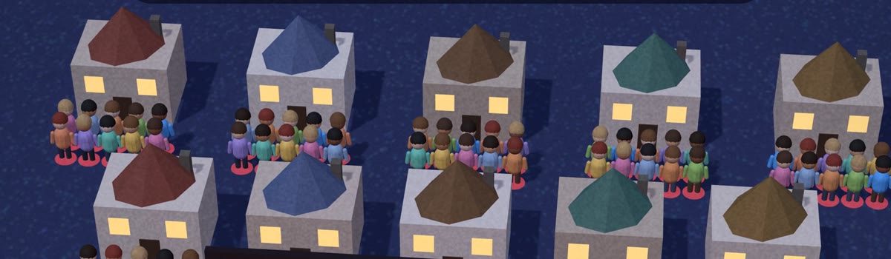
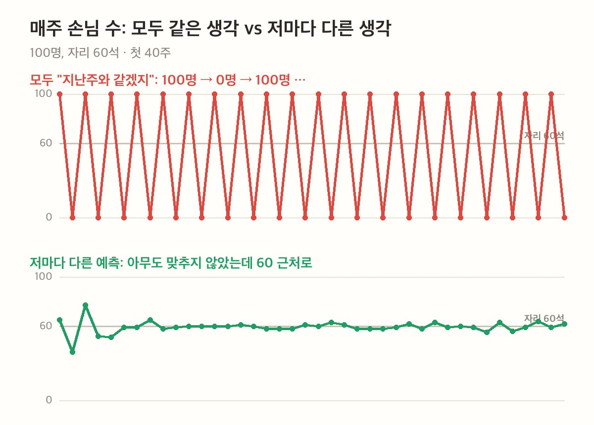
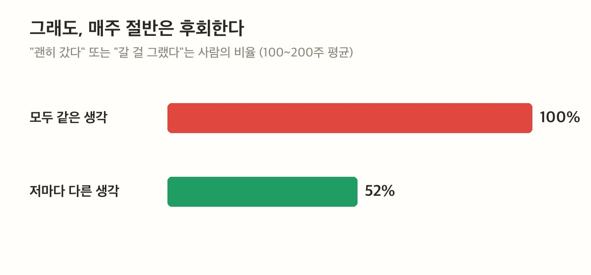

금요일 저녁 일곱 시. 소파에 기대 휴대폰을 든다. 오늘 그 동네에 작은 축제가 열린다. 가고 싶다. 그런데 손가락이 지도 앱 위에서 멈춘다.

분명 사람이 터져 나갈 거야. 줄 서다 지치고, 앉을 데도 없고, 사진에는 남의 뒤통수만 찍히겠지. 한참 망설이다 결국 배달 앱을 연다. **오늘은 집이 최고야.**

{{photo a | 금요일 저녁, 소파 위에서 휴대폰을 들고 망설이는 손 | Photorealistic photo of a hand holding a smartphone over a sofa cushion on a Friday evening, warm living room lamp light, a city night view softly blurred through the window, the phone screen dark or blurred and unreadable, no faces, no logos, no text}}

밤 열 시쯤, 피드에 그 축제 사진이 올라온다. 이상하다. 사람이 별로 없다. 넉넉한 테이블, 여유로운 표정의 사람들, 줄 없는 음식 트럭. 누군가 이렇게 적었다. "생각보다 한산해서 좋았어요."

배달 용기를 정리하며 괜히 억울해진다. **다음 주엔 꼭 가야지.** 그리고 다음 주, 같은 마음을 먹은 사람들로 그곳은 발 디딜 틈이 없었다.

이상하지 않은가. 우리는 매번 사람을 피했는데, 왜 매번 엇갈릴까.

---

### 100명과 자리 60석

이 엇갈림을 확인하려고 작은 동네를 하나 만들었다. 사람은 100명, 동네에 하나뿐인 술집의 자리는 60석이다.

규칙은 하나다. 매주 사람들은 "이번 주 손님이 몇 명일까?"를 짐작한다. **60명보다 적을 것 같으면 가고, 많을 것 같으면 집에 있는다.** 60명 넘게 오면 붐벼서 간 사람이 후회하고, 60명 이하면 집에 있던 사람이 "갈걸" 하고 후회한다.

먼저 모두에게 같은 생각을 주었다. "이번 주도 지난주와 비슷하겠지."

여기서 잠깐 골라 보자. 이 동네의 술집은 어떻게 될까.

- A. 금방 60명 근처로 자리를 잡는다
- B. 붐볐다 비었다를 끝없이 되풀이한다
- C. 점점 아무도 가지 않는다

결과는 B였다. 첫 주에 **100명**이 몰렸다. 다들 지난주가 한산했다고 생각했으니까. 그러자 다음 주는 "지난주에 붐볐으니까" 아무도 오지 않았다. **0명.** 그다음 주는 다시 100명. 100, 0, 100, 0. 200주 내내 그랬다.

매주 모두가 틀렸다. 간 주에는 모두가 붐벼서 후회했고, 안 간 주에는 모두가 텅 빈 술집을 보며 후회했다. **틀린 사람은 매주 100%였다.**

이유는 단순했다. 모두가 같은 정보로 같은 계산을 하면, 모두가 같은 답을 낸다. 그리고 그 답은 모두가 따르는 순간 틀린 답이 된다. **"사람이 적겠지"라는 예측은, 모두가 믿으면 스스로 깨진다.**

---

### 저마다 다른 짐작

이번에는 사람들에게 서로 다른 짐작법을 다섯 개씩 쥐여 주었다. 어떤 사람은 지난주를 따라가고, 어떤 사람은 거꾸로 가고, 어떤 사람은 몇 주의 평균을 낸다. 그리고 최근에 잘 맞았던 짐작법을 골라 쓴다.

아무도 서로 의논하지 않았다. 누구도 "우리 60명만 가자"고 정하지 않았다.

그런데 손님 수가 65, 39, 77, 52를 오가더니, 몇 주 만에 **60명 근처**에 자리를 잡았다. 100주에서 200주 사이의 평균은 **59.5명.** 위아래로 출렁이는 폭도 4명 남짓이었다.

나는 이 선을 한참 바라봤다. 아무도 계획하지 않았는데, 동네 전체가 자리 수를 알아낸 것처럼 움직였다. 서로 다른 짐작이 서로의 실수를 덮어 준 것이다. 누군가 "붐비겠지" 하고 빠지면, 다른 누군가가 "이번엔 비겠지" 하고 그 자리를 채웠다.

1994년 경제학자 브라이언 아서가 바로 이 문제를 내놓았다. 산타페의 한 술집 이름을 따서 **엘 파롤 바 문제**라고 부른다. 그도 100명과 60석으로 실험했다.

하지만 반전이 하나 더 있었다. 동네 전체로는 거의 완벽했는데, 사람 하나하나로 보면 그렇지 않았다. **매주 52%는 여전히 후회했다.** 붐비는 주에는 간 사람이, 한산한 주에는 집에 있던 사람이.

손님이 딱 60명 근처라는 건, 늘 "아슬아슬하다"는 뜻이기도 했다. 한두 명 차이로 붐비거나 한산해진다. 그러니 누구도 매주 맞힐 수는 없다.

@@ 모두 같은 생각과 저마다 다른 생각, 두 동네를 직접 비교해 보자. | 엘 파롤 바 실험, 직접 돌려 보기 | https://simulatiolab.com/bar

---

### 남들 안 갈 때 가는 여행

이 엇갈림은 여행에서 가장 자주 만난다.

연휴는 어디든 붐빈다는 걸 모두가 안다. 그래서 똑똑하게 연휴 바로 다음 주말로 미룬다. 그런데 그 주말, 휴게소 화장실 앞 줄은 연휴 못지않다. **"남들 안 갈 때"라는 생각은, 남들도 한다.**

{{photo b | 한산할 줄 알았던 주말, 줄이 길게 늘어선 휴게소 | Photorealistic photo of a long line of travelers waiting outside a highway rest area building on a weekend afternoon in Korea, people seen from behind or too small to identify, parked cars, slightly tired mood, no readable signs, no logos, no text}}

모두가 같은 앱에서 같은 "붐빔 예상"을 보면 더 그렇다. 앱이 "이 시간대는 한산해요"라고 알려 주는 순간, 그 시간대로 사람이 몰린다. 100과 0을 오가던 그 동네처럼, 정보가 같을수록 우리는 같은 방향으로 엇갈린다.

반대로 이렇게 생각하면 마음이 조금 편해진다. 엇갈림은 내가 눈치가 없어서 생기는 게 아니다. 모두가 똑같이 눈치를 보기 때문에 생긴다. 그리고 동네가 60석을 찾아내려면, 매주 누군가는 틀려야 한다. **그 누군가가 이번 주에는 나였을 뿐이다.**

---

다시 금요일 저녁이다.

휴대폰 속 그 축제 사진을 보며 억울해하던 마음이, 이제는 조금 다르게 보인다. 그날 내가 집에 남은 덕분에 누군가는 넉넉한 테이블에 앉았다. 다음 주 내가 그곳에서 발 디딜 틈 없이 서 있을 때, 누군가는 소파에서 배달 앱을 열었을 것이다.

이번 주는 고민을 짧게 하기로 한다. 붐비면 붐비는 대로, 한산하면 한산한 대로. 신발을 신고 현관문을 연다.

{{photo c | 저녁 축제 거리, 따뜻한 전구 조명 아래 걸어가는 뒷모습 | Photorealistic photo of an evening street festival with warm string lights overhead and food stalls, a person walking toward it seen from behind, a moderate crowd softly blurred, cozy and hopeful mood, faces not identifiable, no logos, no readable signs or text}}

%% 오늘의 인사이트
- **모두가 보는 정보는 모두가 따른다.** 같은 앱의 "한산한 시간" 추천, 같은 블로그의 "숨은 명소"는 알려지는 순간 붐빈다. 정말 한산함을 원하면 남들이 잘 쓰지 않는 기준(평일 아침, 비 오는 날, 덜 알려진 이웃 동네)을 하나 섞자.
- **엇갈림은 실패가 아니라 비용이다.** 사람 많은 곳을 매번 정확히 피할 방법은 없다. 동네 전체가 균형을 찾으려면 매주 절반쯤은 틀린다. 한 번 엇갈린 걸로 내 판단력을 탓하지 말자.
- **고민이 길수록 손해다.** 어차피 절반은 틀리는 게임이라면, 오래 재기보다 빨리 정하고 그 자리를 즐기는 편이 낫다. "붐비면 일찍 나오면 되지" 정도의 퇴로만 정해 두자.

여러분도 "붐빌까 봐 안 갔더니 한산했다더라"는 경험이 있나요? 반대로 "한산할 줄 알았는데 다들 그 생각이었다"는 곳도 댓글로 알려 주세요.

~~ 덧붙임. 글 속의 숫자는 사이트 시뮬레이션 모델 결과다(100명, 자리 60석, 사람마다 지난 8주 기록으로 짐작하는 무작위 예측법 5개, 최근에 잘 맞힌 예측법을 사용, 200주, 시드 1. 평균·출렁임·후회 비율은 100~200주 기준. 시드 10개 평균은 손님 58.1명, 후회 47%). 실제 술집이나 축제의 기록이 아니다. 근거: W. Brian Arthur (1994), "Inductive Reasoning and Bounded Rationality", American Economic Review 84(2), 406–411. 그림은 직접 만든 3D 시뮬레이션 화면과 그래프이며, 글 정리에 AI(Claude)의 도움을 받았다.
